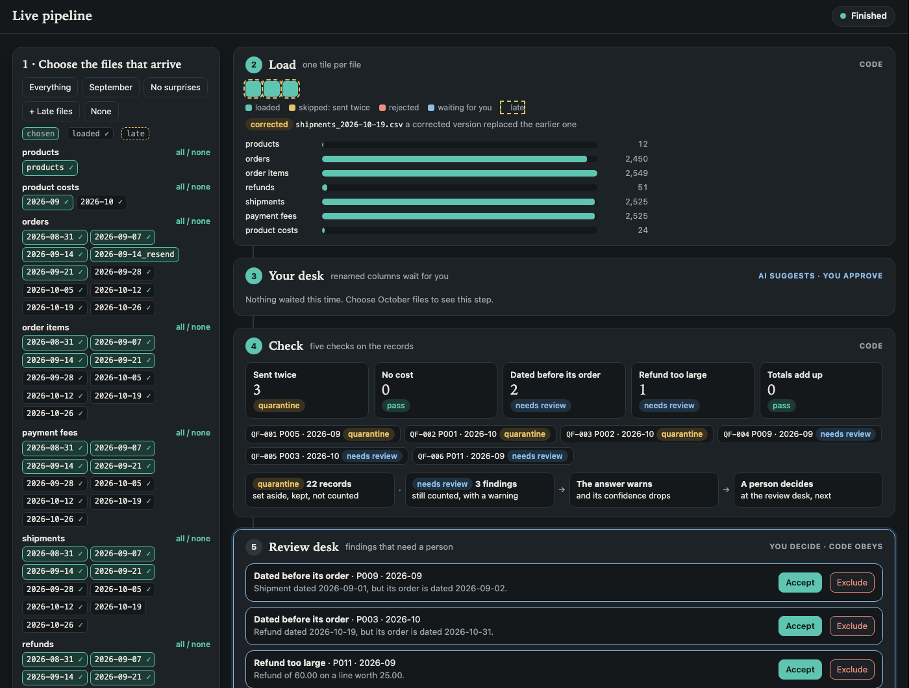
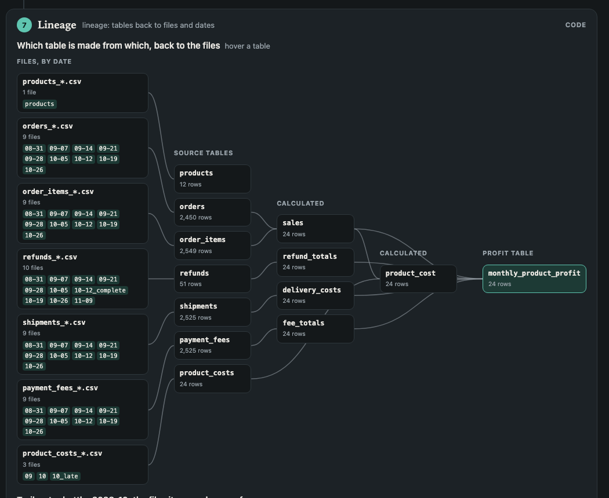
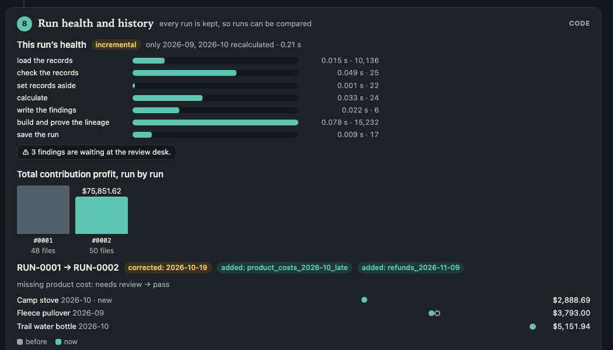
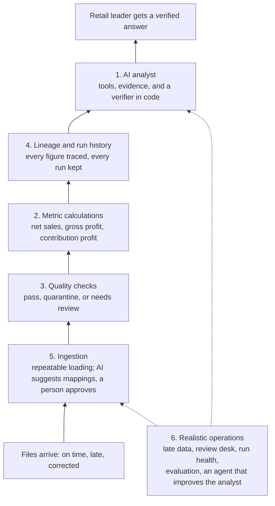

# Retail Profit Stack

**A hands-on AI data engineering project.** Build the data system behind one business question, layer by layer, and learn where AI helps and where code must decide.

> Which products and categories generated the most contribution profit last month, what changed, and how confident should I be in those numbers?

A retail leader asks that question. By the end, an AI analyst answers it from files that were really loaded, records that were really checked, and figures that were really calculated. Every figure can be traced back to the files it came from.



*The live pipeline page. You choose which files arrive, and the project's real production code runs on them.*

## Why this project

Most AI projects stop at a chatbot on top of a table. This one builds what is under the table.

- **One rule, six times.** Code decides and checks. AI drafts, explains, and proposes. A person approves what matters. The model never produces a financial number.
- **It starts at the answer and works backward.** Milestone 1 is an AI analyst on prepared figures. Each later milestone replaces one pretend layer with a real one, so you always see why a layer exists.
- **You do it by hand first.** Every idea is worked out by hand, so you have an answer key before a model or a library touches it.
- **It is a real codebase.** 40 lab notebooks, production code, 1,224 tests, and design documents for every milestone.
- **All data is fictional.** It is generated for a made-up outdoor retailer, Kestrel Ridge Outfitters.

## Try it in two minutes

You need Git, Python 3.12 or later, and [uv](https://docs.astral.sh/uv/). You do **not** need an API key for this part.

```sh
git clone https://github.com/vijaysngrajput/retail-profit-stack.git
cd retail-profit-stack
uv sync
uv run python pipeline_live/server.py
```

Your browser opens the live pipeline. Then:

1. Press **Run the pipeline**. September's files load, the checks run, and the profit figures appear.
2. Click **Everything** and run again. Six files stop at your desk, because their columns were renamed. With an API key, AI suggests what each new column means and you approve. Without one, you type it yourself; the [live pipeline README](pipeline_live/README.md#no-key-it-still-works) has the answers.
3. Click **None**, then **+ Late files**, and run again. Three files arrive after month-end close. Three reported figures change, and the page shows which file caused each one.
4. At the **Review desk**, exclude the refund that is larger than its order line, and run again.

| Lineage: every table back to its files and dates | Run health: what ran, how long it took, and what changed |
|---|---|
|  |  |

## What you build



Data flows up. The project is built from the top down: the numbers are the order you build in.

## Milestones

Work through them in order. Each one is a self-contained folder with its own README.

| Milestone | The data engineering | The AI skill you practise | Notebooks |
|---|---|---|---|
| [1. Mocked business answer](src/m1_mocked_business_answer/) | A profit question answered from prepared figures, with evidence | Your first LLM calls, tools, an agent with structured output, a verifier in code, an evaluation set | 6 |
| [2. Metric and calculation layer](src/m2_metric_calculation_layer/) | Profit calculated from orders, refunds, and costs, on SQL and pandas | AI drafts the calculations and tests judge them; models compared on accuracy, cost, and speed | 6 |
| [3. Quality and trust layer](src/m3_quality_trust_layer/) | Five data quality checks; wrong records are set aside | An agent that plans its own work and investigates a queue of findings | 6 |
| [4. Lineage and run history](src/m4_lineage_run_history/) | Every run kept, every figure traced to its records | Tracing an agent, scoring it, and running experiments | 7 |
| [5. Raw data and ingestion](src/m5_raw_data_ingestion/) | Fifty files loaded repeatably; renamed columns handled by rule | A workflow that pauses for a person, survives a crash, and runs many workers at once | 7 |
| [6. Realistic operations](src/m6_realistic_operations/) | Late and corrected files, incremental runs, a review desk, run health | A judge model, an end-to-end evaluation, and an agent that improves another agent under human approval | 8 |

All six are complete.

## Start here

1. **Understand the business.** Open [understand_business/business_workflow.html](understand_business/business_workflow.html) in a browser. It shows how a product reaches a customer, from five points of view.
2. **Play with the live pipeline** (above), to see where the project ends up.
3. **Set up** your API key (below).
4. **Work through the milestones in order**, starting with [milestone 1](src/m1_mocked_business_answer/).

The pages ending in `.html` are animated. GitHub shows only their source, so view them online here, or open them from your own copy of the project:

- [How a product reaches a customer](https://vijaysngrajput.github.io/retail-profit-stack/understand_business/business_workflow.html)
- Milestone recaps: [1](https://vijaysngrajput.github.io/retail-profit-stack/src/m1_mocked_business_answer/milestone_1_recap.html) · [2](https://vijaysngrajput.github.io/retail-profit-stack/src/m2_metric_calculation_layer/milestone_2_recap.html) · [3](https://vijaysngrajput.github.io/retail-profit-stack/src/m3_quality_trust_layer/milestone_3_recap.html) · [4](https://vijaysngrajput.github.io/retail-profit-stack/src/m4_lineage_run_history/milestone_4_recap.html) · [5](https://vijaysngrajput.github.io/retail-profit-stack/src/m5_raw_data_ingestion/milestone_5_recap.html) · [6](https://vijaysngrajput.github.io/retail-profit-stack/src/m6_realistic_operations/milestone_6_recap.html)

## Who it is for

- You know some Python and a little SQL.
- You have never written LLM or agent code, or you have and want to see it inside a real data system.
- You want to understand what "AI data engineer" means in practice.

You do not need to know retail, LangChain, or data engineering tools. The notebooks explain each one when it first appears.

## What it costs

Everything except the model calls is free and runs on your computer. The labs are tested with `anthropic/claude-haiku-5.5` through [OpenRouter](https://openrouter.ai), a low-cost paid model. A whole milestone's lab costs a few US cents, 15 at most. Each milestone's README says what its lab cost when it was built.

## How every milestone is built

Every milestone follows the same standard, so once you know one you know them all.

**Each milestone is self-contained.** It has its own folder under `src/` with everything it needs, and it imports nothing from another milestone. Code is copied forward from one milestone to the next on purpose, so you can open any milestone and see the whole system at that point, and compare two folders to see how the code improved.

```
src/<milestone>/
  README.md              reading order, and how to run it
  docs/                  BRD.md, HLD.md, LLD.md
  notebooks/             the lab: numbered notebooks, run in order
  retail_profit_stack/   production code
  tests/                 tests for the production code
  data/                  this milestone's data
  evals/                 questions with known correct answers
  milestone_N_recap.html a closing page: what was asked, what you built, what you learned
```

**Each milestone is built in the same order**, the way a real data team works:

1. **Design documents.** Three short documents, each with a data flow diagram:
   - **BRD** (business requirements): what the business needs and why
   - **HLD** (high-level design): the parts of the system and how data moves between them
   - **LLD** (low-level design): the exact tables, formulas, functions, and checks
2. **Lab notebooks.** A short series of Jupyter notebooks that work the solution out step by step. They are written for someone who has never written LLM or agent code.
3. **Production code and tests.** The same logic rebuilt properly, with tests that prove it matches the notebooks.
4. **Recap page.** An animated page to open when you finish, showing how far the data system has come.

**The lab notebooks teach you to use AI to meet a business requirement, and to know how far to trust it.** In every milestone:

- You answer the question by hand first, so you have an answer key.
- Every AI answer is shown beside that key, so you can see whether it was right.
- Each new idea is built by hand once before a library does it for you.
- Each notebook teaches one idea, opens with where you are, and ends with what you now know.
- The design documents are shown inside the notebooks at the point you need them.

## Set up

Install Git, Python 3.12 or later, and [uv](https://docs.astral.sh/uv/). In the project folder, run:

```sh
uv sync
```

Copy `.env.example` to `.env` and add an [OpenRouter](https://openrouter.ai) API key. Keep `.env` private; it is ignored by Git.

Milestones 4 to 6 also use [Langfuse](https://cloud.langfuse.com), a website that keeps a record of every step the AI analyst takes. It has a free plan. Milestone 4's [README](src/m4_lineage_run_history/README.md#set-up-langfuse-once) says how to add its three settings to `.env`. Milestones 1 to 3 do not need it.

The default model is set in `.env.example`. You can set `MODEL_NAME=openrouter/free` to pay nothing, but free models are slow and often fail at the structured calls the labs rely on.

In VS Code, install the Python and Jupyter extensions. Open a notebook, choose **Select Kernel**, then **Python Environments**, and select this project's `.venv`.

See [setup/INSTRUCTIONS.md](setup/INSTRUCTIONS.md) for platform-specific notes.

## Run a milestone

Open the milestone's `README.md` for its reading order and its list of notebooks. To run its tests, which need no API key:

```sh
cd src/m1_mocked_business_answer
uv run pytest
```

## Built with

Python, [uv](https://docs.astral.sh/uv/), DuckDB, pandas, PyArrow, Pydantic, pytest, LangChain, LangGraph, Langfuse, and models reached through OpenRouter.

## About the data

Everything here is fictional: the retailer, the products, the prices, and the costs. The profit definitions are teaching definitions. The project is not affiliated with any real retailer and does not describe any company's systems, data, or accounting. Read [Retail_Profit_Stack.md](Retail_Profit_Stack.md) for the full project overview.

## Licence

[MIT](LICENSE). Use it, change it, and teach with it.
