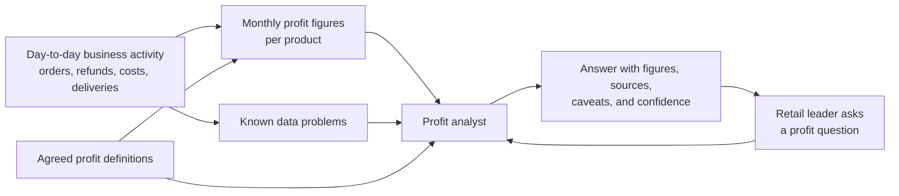

# BRD: Milestone 1, Mocked business answer

**Status:** Approved by the learner; built
**Milestone:** 1 of 6 (see [MILESTONES.md](../../../MILESTONES.md))

> **What this document is.** A business requirements document (BRD) says what the business needs and why, in business language, with no technology. Read it first. Whenever a piece of code or a notebook cell seems arbitrary, the reason for it should trace back to something here. Next, read the [HLD](HLD.md) to see what gets built to meet these needs.

## 1. Business problem

Kestrel Ridge Outfitters is a fictional online retailer of outdoor gear. Its leaders can see sales, but they cannot easily see which products actually make money once discounts, refunds, product cost, and delivery costs are taken out. When they do get a profit figure, they cannot tell where it came from or whether to trust it.

They want to ask a profit question in plain language and get an answer that shows its working.

## 2. People

| Person | What they need |
|---|---|
| Retail leader (asks the question) | A short, correct answer, with the caveats that matter for a decision |
| Finance analyst (checks the answer) | The metric definitions, the figures, and the records behind them |
| Learner (builds the system) | A working slice that every later milestone can deepen |

## 3. The question to answer

> Which products and categories generated the most contribution profit last month, what changed, and how confident should I be in those numbers?

The analyst must also handle the smaller questions inside it:

- What was a given profit metric for a product or category in a given month?
- How did it change from the month before?
- How is a metric defined?
- Is there a known data problem behind a figure?

## 4. Information flow (business view)

In this milestone the monthly profit figures and the known data problems are prepared by hand. Later milestones produce them from the business activity itself.

## 5. What a good answer contains

1. A headline that answers the question in one or two sentences.
2. The figures, each with the month, the product or category, and where it came from.
3. The metric definition used, with its version.
4. The assumptions that shape the figures.
5. Any known data problem that affects those figures.
6. A confidence level (high, medium, or low) with the reasons for it.

## 6. Business rules agreed with the learner

| Rule | Decision |
|---|---|
| Retailer and catalogue | Kestrel Ridge Outfitters, 12 products in 3 categories (Hydration, Camp, Apparel) |
| Time covered | Two months: September 2026 and October 2026 |
| "Last month" | October 2026. It is fixed by the dataset, not by today's date, so answers are repeatable |
| Currency | US dollars, one currency only |
| Refund timing | A refund reduces net sales in the month the refund is issued, not the month of the original order |
| Cancelled orders | An order cancelled before shipping is not a sale and is not counted |
| Missing information | If a figure cannot be calculated, it is reported as unavailable. It is never estimated or treated as zero |

## 7. Profit definitions (business wording)

- **Net sales:** what customers paid for products in the month, after discounts, less refunds issued in the month.
- **Gross profit:** net sales less what the retailer paid its vendors for the units sold.
- **Contribution profit:** gross profit less the costs that rise with each order: fulfilment, shipping, payment fees, and handling returns.

The exact formulas are in the [LLD](LLD.md).

## 8. Scope

**In scope:** one business question and its sub-questions, three profit metrics, two months, twelve products, views by product and by category.

**Out of scope:** forecasts, views by sales channel or customer, fixed costs such as salaries and marketing, tax, multiple currencies, charts or dashboards, and any real company's data.

## 9. Success criteria

- Every figure in an answer can be traced to a stored value. None is produced by the AI model.
- Every answer names its sources and the metric definition version.
- The answer to the main question names the top products and categories, describes the change from September, and gives a confidence level with reasons.
- A known data problem behind a figure is mentioned and lowers the confidence.
- A question outside the scope above is declined with an explanation.

## 10. Assumptions

- All data is fictional and was invented for learning. It does not describe any real retailer.
- The monthly figures are prepared in advance for this milestone and are assumed to follow the profit definitions. Milestone 2 replaces them with real calculations.
- Returned units are treated as not resaleable, so their product cost is not credited back.
