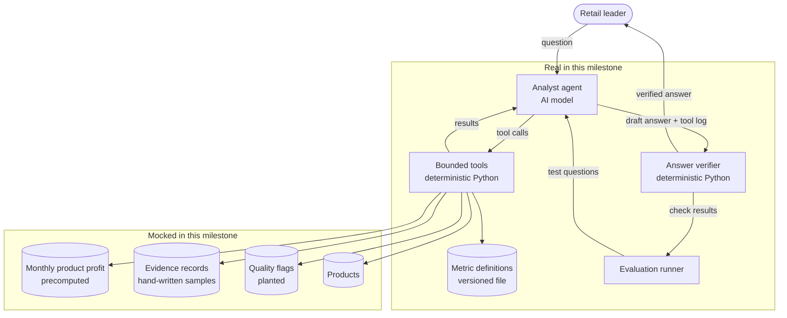

# HLD: Milestone 1, Mocked business answer

**Status:** Approved by the learner; built
**Satisfies:** [BRD](BRD.md)

> **What this document is.** A high-level design (HLD) names the parts of the system, what each part is responsible for, and how data moves between them. It does not give exact columns or function signatures. Read it after the [BRD](BRD.md) and before the notebook, so that each notebook section has a place on the map below. The [LLD](LLD.md) then gives the exact detail of each part.

## 1. Approach

Build the business-facing end first. An AI analyst answers the profit question by calling a small set of approved tools. The tools read hand-prepared mock tables. Code checks the answer before the user sees it.

Everything upstream of the tools is mocked. The tools, the answer format, and the evaluation set are real and become the project's fixed contracts.

## 2. Components and data flow

## 3. Component responsibilities

| Component | Responsibility | Real or mock |
|---|---|---|
| Mock tables | Hold monthly profit per product, sample source records, known data problems, and the product list | Mock |
| Metric definitions | State each metric's formula, components, assumptions, and version | Real |
| Bounded tools | The only way to reach data. Look up definitions, query and compare profit, fetch evidence, fetch quality flags and the confidence level | Real |
| Analyst agent | Understand the question, choose tools, and write the structured answer from tool results | Real |
| Answer verifier | Check that every figure matches a tool result, sources are cited, and the confidence level matches the rule | Real |
| Evaluation runner | Run known questions and report which checks pass | Real |

## 4. Where AI is used and where it is not

| Task | Done by |
|---|---|
| Interpreting the question | AI model |
| Choosing which tools to call | AI model |
| Wording the headline, narrative, and caveats | AI model |
| Deciding a question is out of scope | AI model, then confirmed by checks in evaluation |
| Reading, summing, ranking, and comparing figures | Tools (code) |
| Setting the confidence level | Tools (code), from the severity of quality flags |
| Deciding whether an answer is acceptable | Verifier (code) |
| Drafting the metric definitions | AI-assisted in the notebook, then reviewed and fixed in the definitions file by the learner |

The model never adds, subtracts, ranks, or rounds a figure. If it needs a number, a tool must return it.

## 5. Interfaces

Six tools form the tool interface. Exact signatures are in the [LLD](LLD.md).

| Tool | Purpose |
|---|---|
| `get_reporting_period` | Says which month "last month" is and which months have data |
| `get_metric_definition` | Returns a metric's formula, assumptions, and version |
| `query_profit` | Returns metric values by product or category for a month, ranked |
| `compare_profit` | Returns the change between two months, by product or category |
| `get_evidence` | Returns sample source records behind a product's monthly figures |
| `get_quality_flags` | Returns known data problems for a scope, and the resulting confidence level |

The agent returns one structured answer: status, headline, narrative, figures, definitions used, assumptions, caveats, confidence, and sources.

## 6. Key design decisions

| Decision | Reason |
|---|---|
| Tools are the only path to data | Makes "the model never invents a figure" checkable |
| A verifier checks every answer | A wrong figure is caught by code, not by the reader |
| Confidence comes from a rule, not from the model | Two runs on the same data give the same confidence |
| Category totals are summed by a tool from product rows | One stored table, one grain, no totals that can disagree |
| Unavailable figures stay empty | A missing cost is shown as a gap and flagged, never as zero |
| "Last month" comes from the dataset | Answers and tests do not change with the calendar |
| A fake model is used in tests | Tests run offline, without a key, with the same result every time |

## 7. Technology

Python 3.12, CSV files in this milestone's `data/mock/` folder, DuckDB for queries, Pydantic for schemas, LangChain for the agent, and OpenRouter for the model (configured through `.env`). No new dependencies are needed.

## 8. Risks

| Risk | Handling |
|---|---|
| A weak model may handle tool calls or structured answers poorly (free models often do) | The default is a low-cost paid model that handles both well. The model name is configurable. The verifier reports failures plainly so a weak model is visible, not hidden |
| Live model answers vary between runs | Tests use the fake model. Live evaluation reports a pass rate per check |
| The model states a number in prose that no tool returned | The verifier scans the headline and narrative for numbers and fails the answer if one is unmatched |

## 9. What later milestones replace

| Mock here | Replaced in |
|---|---|
| Monthly product profit | Milestone 2, real transformations |
| Quality flags | Milestone 3, real checks |
| Evidence records | Milestone 2 (real source rows) and Milestone 4 (lineage) |
| Mock tables as a whole | Milestone 5, ingestion |
