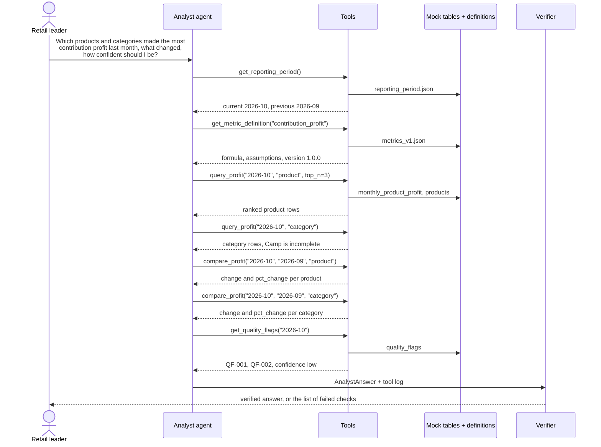

# LLD: Milestone 1, Mocked business answer

**Status:** Approved by the learner; built
**Fits inside:** [HLD](HLD.md)

> **What this document is.** A low-level design (LLD) gives the exact detail needed to build each part named in the [HLD](HLD.md): table columns, formulas, function signatures, and checks. Keep it open beside the notebook and the code. Section 11 tells you which part of the lab and which code file build each part of this document.

Sections 2, 4, and 5 define the project's fixed contracts. Review them most closely.

## 1. Files

Everything lives inside this milestone's folder, `src/m1_mocked_business_answer/`. Nothing imports from another milestone. Paths below are relative to that folder.

```
docs/                           BRD.md, HLD.md, LLD.md
notebooks/                      the lab: six short notebooks, run in order
  01_the_business_question.ipynb
  02_first_llm_calls.ipynb
  03_llm_with_all_the_data.ipynb
  04_tools_and_agents.ipynb
  05_the_agent_answers.ipynb
  06_verify_and_production.ipynb
  lab_helpers.py                finished versions of what the notebooks build, for reuse
  results/                      what each notebook saves for the next (answer_key.json is kept;
                                the learner's own AI answers are not committed)
data/mock/
  products.csv
  monthly_product_profit.csv
  evidence_records.csv
  quality_flags.csv
  reporting_period.json
retail_profit_stack/            production package
  definitions/metrics_v1.json   metric definitions (versioned)
  config.py                     paths and settings
  schemas.py                    Pydantic models for tables, tool results, the answer
  mock_data.py                  writes the mock CSVs from hand-chosen inputs
  store.py                      loads and validates the tables into DuckDB
  tools.py                      the six tools
  agent.py                      builds the analyst agent, records the tool log
  verify.py                     the answer verifier
  evaluation.py                 runs the evaluation set
evals/m1_cases.json             evaluation cases
tests/                          one test module per source module, plus helpers.py
pytest.ini                      lets `uv run pytest` work from this folder
```

The Python environment (`pyproject.toml`, `uv.lock`, `.env`) is shared at the project root.

## 2. Metric definitions (version 1.0.0)

All amounts are US dollars, rounded to 2 decimal places. A month is written `YYYY-MM`.

| Term | Formula |
|---|---|
| `units_sold` | Units on order items placed in the month, excluding cancelled orders |
| `gross_sales` | Sum of quantity × list price for items ordered in the month, excluding cancelled orders |
| `discounts` | Sum of discounts on those items |
| `refunds` | Sum of refund amounts issued in the month |
| **`net_sales`** | `gross_sales − discounts − refunds` |
| `product_cost` | Sum of units sold × unit cost for those items |
| **`gross_profit`** | `net_sales − product_cost` |
| `fulfillment_cost` | Pick-and-pack cost for orders shipped in the month |
| `shipping_cost` | Carrier cost for orders shipped in the month |
| `payment_fees` | Payment provider fees on payments captured in the month |
| `return_cost` | Cost of handling returns for refunds issued in the month |
| **`contribution_profit`** | `gross_profit − fulfillment_cost − shipping_cost − payment_fees − return_cost` |

Rules:

- If any component of a metric is missing, the metric is missing (null). Nothing is estimated or treated as zero.
- Returned units are not resaleable, so `product_cost` is not reduced by returns.
- The three bold metrics are the approved metrics. The other nine terms are components and can be reported alongside them.

`metrics_v1.json` holds, for each of the twelve terms: `name`, `version`, `approved`, `unit`, `description`, `formula`, `components`, `assumptions`.

## 3. Mock tables

**`products.csv`** (12 rows)

| Column | Type | Notes |
|---|---|---|
| `product_id` | text | `P001` to `P012`, unique |
| `product_name` | text | |
| `category` | text | `Hydration`, `Camp`, or `Apparel`; 4 products each |

**`monthly_product_profit.csv`** (24 rows; one per product per month)

| Column | Type | Notes |
|---|---|---|
| `month` | text | `2026-09` or `2026-10` |
| `product_id` | text | Must exist in `products.csv` |
| `units_sold` | integer | |
| `gross_sales`, `discounts`, `refunds`, `net_sales` | decimal | |
| `product_cost`, `gross_profit` | decimal, nullable | Null when cost is missing |
| `fulfillment_cost`, `shipping_cost`, `payment_fees`, `return_cost` | decimal | |
| `contribution_profit` | decimal, nullable | Null when `gross_profit` is null |
| `metric_version` | text | `1.0.0` |

Every row must satisfy the formulas in section 2. A test checks this.

**`evidence_records.csv`** (about 3 per product per month)

| Column | Type | Notes |
|---|---|---|
| `evidence_id` | text | `EV-0001`, unique |
| `month`, `product_id` | text | |
| `record_type` | text | `order_item`, `refund`, `product_cost`, `payment_fee`, or `shipment` |
| `source_table` | text | The table the record would come from, for example `orders` |
| `source_record_id` | text | For example `ORD-10231` |
| `amount` | decimal | |
| `description` | text | |

These are samples. They illustrate a figure and do not add up to it. Every tool result that returns them says so.

**`quality_flags.csv`** (3 planted rows)

| Column | Type | Notes |
|---|---|---|
| `flag_id` | text | `QF-001`, unique |
| `month` | text | |
| `product_id` | text | |
| `check_name` | text | |
| `severity` | text | `high`, `medium`, or `low` |
| `affected_metrics` | text | Metric names separated by `;` |
| `description` | text | |

| Flag | Problem | Severity | Effect |
|---|---|---|---|
| `QF-001` | Camp stove has no product cost for 2026-10 | high | Its gross and contribution profit are null. The Camp category total is incomplete |
| `QF-002` | Three orders for the top Hydration product appear twice in 2026-10 | medium | Its net sales and profit may be overstated |
| `QF-003` | A 2026-09 refund for an Apparel product is larger than the order it refunds | low | That product's September net sales may be understated, which affects its month-over-month change |

**`reporting_period.json`**: `as_of_date` `2026-11-01`, `current_month` `2026-10`, `previous_month` `2026-09`.

## 4. Tools

Each tool is a plain function that returns a Pydantic model. Every result includes `sources`: a list of `{table, keys}` naming the rows it read.

```python
def get_reporting_period() -> ReportingPeriod
    # as_of_date, current_month, previous_month, available_months

def get_metric_definition(metric: str) -> MetricDefinition
    # name, version, description, formula, components, assumptions

def query_profit(
    month: str,
    group_by: Literal["product", "category"],
    metric: str = "contribution_profit",
    top_n: int | None = None,
) -> ProfitResult
    # rows: entity_id, entity_name, category, all section 2 terms,
    #       rank, is_complete; metric_version

def compare_profit(
    month: str,
    previous_month: str,
    group_by: Literal["product", "category"],
    metric: str = "contribution_profit",
) -> ProfitComparison
    # rows: entity_id, entity_name, current, previous, change, pct_change,
    #       is_complete

def get_evidence(month: str, product_id: str, limit: int = 5) -> EvidenceResult
    # records, is_sample=True

def get_quality_flags(
    month: str,
    product_id: str | None = None,
    category: str | None = None,
) -> QualityResult
    # flags, confidence_level, confidence_reasons
```

Tool rules:

- **Ranking:** rows are ranked by the chosen metric, highest first. Rows with a null value are unranked and listed last.
- **Category rows:** summed from product rows. If any product in the category has a null value, the sum covers the other products and `is_complete` is false. Example: Camp's October contribution profit is the sum of three products, because the camp stove has none.
- **Comparison:** `change = current − previous`. `pct_change = change ÷ previous × 100`, rounded to 1 decimal place. Both are null if either month's value is null or incomplete, because a partial total cannot be compared with a full one. `pct_change` is also null if `previous` is zero. Rows are sorted from the biggest fall to the biggest rise, with rows that have no change last.
- **Confidence:** the highest severity among the returned flags sets the level. `high` severity gives `low` confidence, `medium` gives `medium`, `low` or no flags gives `high`. Each flag contributes one reason.
- **Parallel calls:** an agent may call several tools at once, each on its own thread. The store lets one query run at a time, so results never mix.
- **Bad input:** an unknown month, metric, product, or category raises a `ToolInputError` with a message listing the valid values. The agent receives that message as the tool's reply, so it can correct itself, and the failed call is recorded in the tool log.

## 5. Answer format

```python
class Figure:
    label: str                      # "Trail water bottle, contribution profit"
    metric: str                     # a section 2 term
    kind: Literal["value", "change", "pct_change"]
    value: float | None             # None means unavailable
    unit: Literal["USD", "percent", "units"]
    month: str
    entity_type: Literal["product", "category"]
    entity_id: str
    source_tool: str                # the tool that returned it

class AnalystAnswer:
    status: Literal["answered", "declined"]
    headline: str
    narrative: str
    figures: list[Figure]
    definitions_used: list[DefinitionRef]   # metric, version
    assumptions: list[str]
    caveats: list[Caveat]                   # flag_id (optional), text
    confidence: Confidence | None           # level, reasons
    sources: list[SourceRef]                # table, keys
    decline_reason: str | None
```

A declined answer has no figures and no confidence, and must give a `decline_reason`.

## 6. Agent

- Built with LangChain's `create_agent`, the six tools, and `AnalystAnswer` as the structured response. The answer is requested through a tool call (`ToolStrategy`), which works with any model that can call tools.
- Each tool is wrapped so that every call, its arguments, and its result are appended to the tool log.
- The model is `ChatOpenAI` pointed at OpenRouter, using `OPENROUTER_API_KEY` and `MODEL_NAME` from `.env`.
- The system prompt states the scope, the approved metrics, the rule that every number must come from a tool, and when to decline.
- `run_analyst(question, model=None) -> AnalystRun` returns the answer, the tool log (each call's name, arguments, and result), and the verification report. Passing a `model` lets tests supply a fake. A model or network failure is reported in `AnalystRun.error`, not raised, so the tool log is never lost.

## 7. Request trace for the main question



## 8. Verifier checks

| Check | Passes when |
|---|---|
| `figures_match_tools` | Every figure's value equals a value in the named tool's results for the same metric, month, and entity |
| `no_unsupported_numbers` | Every number in the headline and narrative matches a number in the run's tool results, allowing for rounding and currency formatting. Dates, identifiers, version numbers, and counts up to 12 are ignored |
| `sources_cited` | An answered response lists at least one source, and each source appears in the tool log |
| `definitions_stated` | Each metric used in a figure has a definition reference with the current version |
| `confidence_matches_rule` | An answer with figures has a confidence level equal to the level returned by `get_quality_flags` in that run (the worst one if it was called more than once) |
| `flags_mentioned` | Every flag that `get_quality_flags` returned in the run appears in the caveats by `flag_id`. If the agent fetched a flag, it must report it |
| `decline_is_clean` | A declined answer has no figures and has a reason |

## 9. Evaluation set

`evals/m1_cases.json` holds, per case: the question, the expected status, expected figures, expected flag IDs, expected definitions, and expected confidence. Three cases (E1, E2, E6) are marked `tiny` for a short run that fits a free model's daily limit.

| Case | Question | Expected |
|---|---|---|
| E1 | The main question | Top 3 products and top category for 2026-10, their changes, `QF-001` and `QF-002`, confidence low |
| E2 | Net sales for Hydration in September | One figure, confidence high |
| E3 | How is contribution profit defined? | Definition version 1.0.0, no figures |
| E4 | Why is the camp stove missing from the ranking? | `QF-001`, figure unavailable, confidence low |
| E5 | Which category's contribution profit fell the most since September? | The correct category and its change |
| E6 | What will profit be next quarter? | Declined |
| E7 | What is our profit after marketing spend? | Declined |

The runner applies the section 8 checks plus the expected values and reports pass or fail per check per case.

An answer produced without tools (the single model call in the lab) has no tool log of its own. It is scored against `full_tool_log()`, which holds every figure the tools can return, and the two checks that depend on what a run fetched (`confidence_matches_rule` and `flags_mentioned`) are left out. The case's expected flags and expected confidence cover them.

## 10. Tests

All tests run offline with no API key.

| Area | What is tested |
|---|---|
| Mock data | Schemas, row counts, product references, and the section 2 formulas on every row |
| Definitions | Every term loads, has a version, and its components exist |
| Tools | Ranking, null handling, category sums and `is_complete`, comparison maths, the confidence rule, bad input, and several tools called at the same time |
| Verifier | Each check passes a correct answer and fails a deliberately broken one |
| Agent | With a scripted fake model: the tool log is recorded and the answer is verified |
| Evaluation | The runner scores scripted answers correctly |
| Notebook parity | Each production tool returns the same result as the lab's version of it in `notebooks/lab_helpers.py`, for the same arguments |

## 11. Where each part is built

The lab is six short notebooks, run in order. Each teaches one idea, shows the document sections it relies on, and saves a result for the next. Code that a later notebook reuses lives in `notebooks/lab_helpers.py`.

| Notebook | What the learner does | Documents shown | This document's sections | Production code |
|---|---|---|---|---|
| 1. The business question | Reads the brief, explores the data, answers the question by hand, and saves the answer key | BRD 1, 3, 7 | 3. Mock tables | `mock_data.py`, `store.py`, `data/mock/` |
| 2. Your first LLM calls | Makes a plain call and a structured call, and has AI draft the metric definitions | BRD 6 and LLD 2 | 2. Metric definitions | `definitions/metrics_v1.json` |
| 3. Ask the LLM with all the data | Asks the question with the data in the prompt and checks the answer against the key | BRD 5 | 5. Answer format | `schemas.py` |
| 4. What is a tool, what is an agent | Builds one tool, runs the agent loop by hand, then lets LangChain run it | None | 4. Tools (the idea) | None |
| 5. The agent answers the question | Gives an agent the six tools and compares the key, the single call, and the agent | HLD 2, 4, 5 | 4. Tools, 6. Agent, 7. Request trace | `tools.py`, `agent.py` |
| 6. Verify and go to production | Verifies an answer with code, tries to fool the verifier, and maps the notebooks to production | LLD 8 | 8. Verifier checks, 9. Evaluation set, 10. Tests | `verify.py`, `evaluation.py`, `tests/` |
