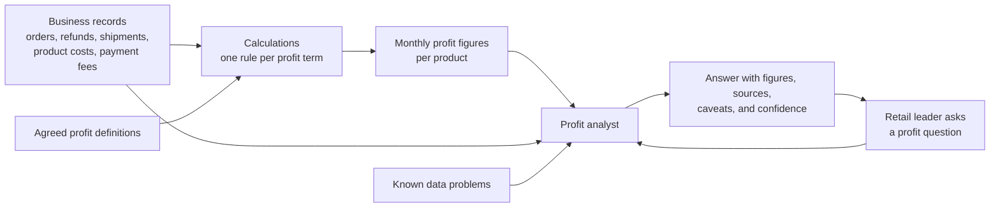

# BRD: Milestone 2, Metric and calculation layer

**Status:** Approved by the learner; built
**Milestone:** 2 of 6 (see the project [README](../../../README.md#milestones))

> **What this document is.** A business requirements document (BRD) says what the business needs and why, in business language, with no technology. Read it first. Whenever a piece of code or a notebook cell seems arbitrary, the reason for it should trace back to something here. Next, read the [HLD](HLD.md) to see what gets built to meet these needs.

## 1. Business problem

In milestone 1, Kestrel Ridge Outfitters got an analyst that answers profit questions and shows its working. But the profit figures behind it were prepared by hand. Nobody can say how the trail water bottle's $5,188.20 was arrived at, and nobody could reproduce it next month.

Finance will not sign off on a number that cannot be recalculated. The business needs every profit figure to be **calculated from its own records**, by rules that are written down, the same way every time.

Two more needs come with that:

- **The calculation must outlive the tools it runs on.** Today the data is small. As the retailer grows, the same rules will have to run on much larger data, with different technology. The rules must not need rewriting when that happens.
- **AI should help write the calculations, and the business wants to know which AI to use.** Models differ in how well they do this work, how fast they are, and what they cost.

## 2. People

| Person | What they need |
|---|---|
| Retail leader | The same answers as before, now backed by real calculations |
| Finance analyst | To see, for any figure, the rule that produced it and the records it came from |
| Head of data | Calculations that can move to a different engine as data grows, without changing the rules |
| Learner (builds the system) | To use AI to draft calculations, to know how to judge its work, and to choose a model on evidence |

## 3. The questions to answer

The leader's question from milestone 1 is unchanged and must get the same answer:

> Which products and categories generated the most contribution profit last month, what changed, and how confident should I be in those numbers?

This milestone adds three questions of its own:

1. **For finance:** how exactly is each profit figure calculated from our records?
2. **For the head of data:** if we change the technology that runs the calculations, do we get the same figures?
3. **For the learner:** which model drafts a correct calculation most reliably, and what does it cost in money and time?

## 4. Information flow (business view)

Compared with milestone 1, the monthly profit figures are no longer prepared by hand. They are produced by the calculations, from the business records. The analyst can also show the actual records behind a figure.

## 5. What a good result looks like

1. Every figure in the monthly profit table is produced by a written rule from the business records.
2. Running the calculations twice on the same records gives exactly the same figures.
3. Running them on a different engine gives exactly the same figures.
4. The figures equal milestone 1's, so the leader's answer does not change.
5. For any figure, the analyst can show real records that fed it.
6. The learner can show, with numbers, how each AI model performed at drafting the calculations.

## 6. Business rules agreed with the learner

The rules from milestone 1 still apply. These are added or made exact.

| Rule | Decision |
|---|---|
| Same figures as milestone 1 | The business records are generated so that the calculated figures equal milestone 1's prepared figures exactly |
| When a sale counts | In the month the order was placed |
| When a refund counts | In the month the refund was issued, even if the order was placed in an earlier month |
| When delivery costs count | Pick-and-pack and carrier costs count in the month the item shipped |
| When payment fees count | In the month the payment was captured |
| Cancelled orders | Not a sale. Nothing from a cancelled order is counted |
| Missing product cost | The product's cost, gross profit, and contribution profit are unavailable for that month. Never zero, never estimated |
| Duplicated records | Counted as they appear. Finding and removing them is the job of the quality checks in milestone 3. Until then the known duplicates stay flagged |
| Which engines | The calculations run on two engines now: pandas (for small data) and SQL (for medium data). The design must leave room for PySpark (for large data) |
| Which models | Only models available through OpenRouter. Nothing is installed on the learner's computer |
| Who decides if AI's work is accepted | Tests with hand-worked examples decide. A person reviews anything that goes into production |

## 7. Scope

**In scope:** business records for two months and twelve products; one calculation per profit term; two engines; hand-worked examples that judge every calculation; AI drafting calculations in SQL and pandas; a comparison of several models on accuracy, cost, and speed; an agent that fixes its own draft using the tests.

**Out of scope:** real data quality checks (milestone 3), tracing a figure through every step (milestone 4), loading records from files (milestone 5), late or corrected records (milestone 6), building the PySpark engine, new profit metrics, dashboards.

## 8. Success criteria

- The calculated monthly profit table equals milestone 1's table, value for value.
- Both engines produce identical output for every calculation.
- Each calculation is proven by hand-worked examples, including a discounted order, a cancelled order, a refund issued in a later month, and a product with no cost.
- Milestone 1's evaluation questions still pass, now on calculated figures.
- The analyst's evidence comes from real business records.
- The model comparison reports, for each model and each language, the share of examples passed, the cost, and the time.
- No calculation written by AI is used for a business figure until it has passed the tests and been reviewed.

## 9. Assumptions

- All data is fictional and generated for learning.
- The business records are still generated, not loaded from real systems. Milestone 5 replaces the generator.
- The known data problems are still listed by hand. They are now visible in the records themselves: the missing cost, the duplicated orders, and the oversized refund are really there.
- Returned units are treated as not resaleable, as in milestone 1.
