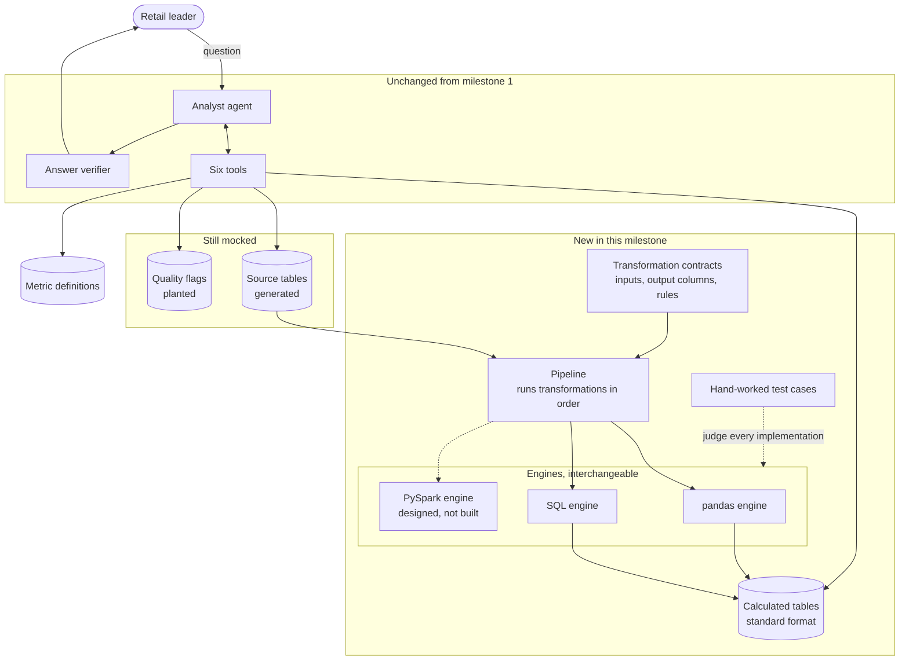
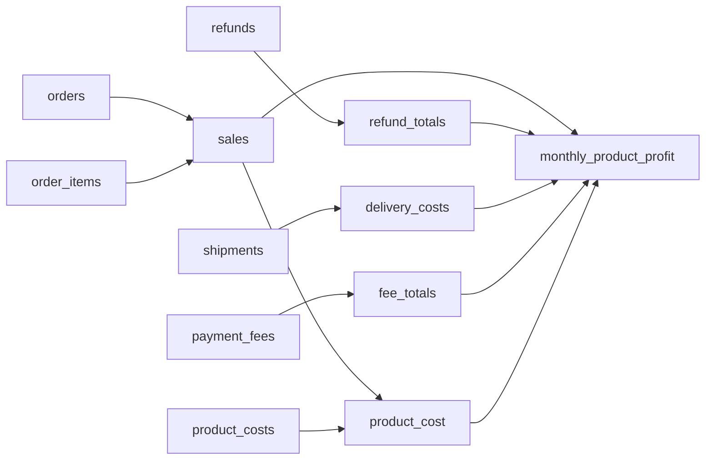

# HLD: Milestone 2, Metric and calculation layer

**Status:** Approved by the learner; built
**Satisfies:** [BRD](BRD.md)

> **What this document is.** A high-level design (HLD) names the parts of the system, what each part is responsible for, and how data moves between them. It does not give exact columns or function signatures. Read it after the [BRD](BRD.md) and before the notebooks. The [LLD](LLD.md) then gives the exact detail of each part.

## 1. Approach

Replace one mock: the prepared profit table. A **transformation layer** now calculates it from business records. Everything above it (the six tools, the analyst, the verifier) stays as it was, and must not notice the difference.

The transformation layer is designed so that the **rule** and the **engine that runs it** are separate. A rule is defined once as a contract. Each engine supplies its own implementation of the rule, and every implementation must produce the same output in the same standard format.

AI is used to draft the implementations. Tests with hand-worked examples judge every draft.

## 2. What changed since milestone 1

| Part | Milestone 1 | Milestone 2 |
|---|---|---|
| Monthly profit table | Prepared by hand | Calculated by the transformation layer |
| Evidence records | Hand-written samples | Real rows from the source tables |
| Source tables | Did not exist | Generated: orders, order items, refunds, shipments, payment fees, product costs |
| Transformation layer | Did not exist | New: contracts, two engines, implementations, pipeline |
| AI's work | Answering the question | Also drafting the transformations |
| Six tools, answer format, verifier | Built | Unchanged |
| Quality flags | Planted | Still planted (milestone 3) |

## 3. Components and data flow

## 4. Component responsibilities

| Component | Responsibility | Real or mock |
|---|---|---|
| Source tables | The business's records: orders, order items, refunds, shipments, payment fees, product costs | Mock (generated) |
| Transformation contract | For one transformation: its name, the tables it reads, the exact columns it must produce, and the business rule | Real |
| Engine | Knows how to run one kind of implementation and return the result in the standard format | Real (pandas, SQL) |
| Implementation | The code for one transformation on one engine: a SQL query, or a pandas function | Real |
| Pipeline | Runs the transformations in dependency order on the chosen engine and stores the results | Real |
| Calculated tables | The outputs, in one standard format whatever engine produced them | Real |
| Hand-worked test cases | Small inputs with outputs worked out by hand. They judge every implementation, on every engine, whoever wrote it | Real |
| Six tools, analyst, verifier | As in milestone 1. The tools now read the calculated tables | Real |
| Quality flags | Known data problems | Mock |

## 5. The transformations

Six transformations produce the monthly profit table. Each is small enough to reason about and test by hand.

| Transformation | What it calculates |
|---|---|
| `sales` | Units sold, gross sales, and discounts, by product and order month, leaving out cancelled orders |
| `refund_totals` | Refunds and return handling cost, by product and refund month |
| `delivery_costs` | Pick-and-pack and carrier cost, by product and ship month |
| `fee_totals` | Payment fees, by product and capture month |
| `product_cost` | Units sold times unit cost. Unavailable when the cost is missing |
| `monthly_product_profit` | Brings the five together and calculates net sales, gross profit, and contribution profit |

## 6. One rule, many engines

| Idea | What it means here |
|---|---|
| Contract | A transformation is described without any engine in it: what goes in, what must come out, and the rule |
| Adapter | Each engine is a class with the same small interface. The pipeline talks to the interface and does not know which engine is behind it |
| Implementation per engine | The same transformation has a SQL query for the SQL engine and a function for the pandas engine |
| Standard output format | Every engine returns its result as an Apache Arrow table that matches the contract's columns and types. Arrow is a table format that pandas, SQL engines, and Spark all read and write |
| Conformance | The same hand-worked test cases run against every engine. All engines must agree, value for value |
| One switch | A setting chooses the engine. Nothing else changes |

| Engine | Suited to | In this milestone |
|---|---|---|
| pandas | Small data that fits in memory | Built and tested |
| SQL (DuckDB) | Medium data on one machine | Built and tested; the default |
| PySpark | Large data across many machines | Interface and file layout reserved; not built |

## 7. Where AI is used and where it is not

| Task | Done by |
|---|---|
| Drafting a transformation in SQL or pandas from its contract | AI model |
| Fixing a draft after seeing which test cases failed | AI agent, using a test-running tool |
| Deciding whether a draft is correct | Hand-worked test cases (code) |
| Comparing models on accuracy, cost, and speed | Code, from test results and usage figures |
| Writing the test cases and their expected outputs | A person, by hand |
| Choosing what goes into production | A person, after the tests pass |
| Calculating business figures | Reviewed, versioned implementations, run by an engine |
| Answering the leader's question | The analyst agent, as in milestone 1 |

The model never produces a business figure. It produces code, and the code is trusted only after tests pass and a person has reviewed it.

## 8. Key design decisions

| Decision | Reason |
|---|---|
| Rules are contracts, separate from engines | The business rule survives a change of technology (BRD section 1) |
| Six small transformations, not one large query | Each can be tested by hand, drafted by AI on its own, and scored separately |
| Each source table is summed on its own before anything is joined | Joining detail rows to detail rows multiplies them and inflates totals. This is the most common mistake in this kind of work |
| Engines exchange Apache Arrow tables | One format that every engine, present and future, can produce |
| The same test cases judge every engine and every AI draft | "Correct" has one meaning, set by a person |
| The profit table keeps milestone 1's exact columns | The six tools and the evaluation set work unchanged |
| Duplicated records are counted, not removed | Quality is milestone 3's job. Removing them now would change milestone 1's figures |
| AI-written code runs with restrictions | A model's code is untrusted until reviewed. See the LLD for the limits |
| Only OpenRouter models | The learner chose not to install models locally |

## 9. Technology

Python 3.12, DuckDB, pandas, Pydantic, LangChain, and OpenRouter, as before. Two additions: **pyarrow**, for the standard table format, and **plotly**, for the comparison charts. Calculated tables are stored as Parquet files in this milestone's `data/warehouse/` folder.

## 10. Risks

| Risk | Handling |
|---|---|
| Running code written by a model could do something unwanted on the learner's computer | SQL runs in an in-memory database with file and network access switched off. pandas code is checked before it runs (only an allowed set of imports and no file, network, or system calls) and runs in a separate process with a time limit. The lab shows the code before running it |
| The two engines disagree by a cent because of rounding | The contract fixes the rounding rule, and conformance tests compare the engines on every case |
| The comparison costs more than expected | A small-run switch, a printed cost per run, and inexpensive models by default |
| A model on OpenRouter is withdrawn or renamed | The model list is one setting at the top of the notebook, and each model is checked when the lab is built |
| The design is more than a beginner needs | The lab builds it up from one hand-written transformation, in pandas and then SQL, before the adapter is introduced |

## 11. What later milestones replace

| Mock here | Replaced in |
|---|---|
| Quality flags, and the duplicated records they describe | Milestone 3, real checks |
| Evidence as a sample of source rows | Milestone 4, full lineage |
| Generated source tables | Milestone 5, ingestion |
| The PySpark engine slot | A later milestone, when data volume calls for it |
