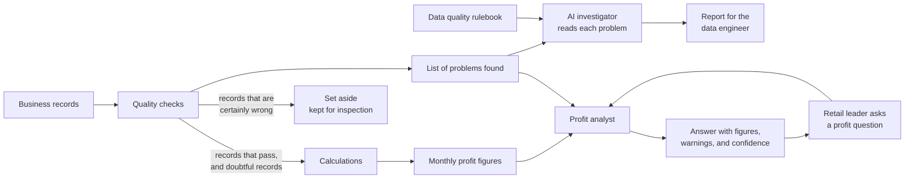

# BRD: Milestone 3, Quality and trust layer

**Status:** Final; built
**Milestone:** 3 of 6 (see the project [README](../../../README.md#milestones))

> **What this document is.** A business requirements document (BRD) says what the business needs and why, in business language, with no technology. Read it first. Next, read the [HLD](HLD.md) to see what gets built to meet these needs.

## 1. Business problem

After milestone 2, Kestrel Ridge Outfitters calculates its profit from its own records. But nobody checks those records.

The warnings the analyst gives ("three orders appear twice") come from a list a person wrote by hand. If that person misses a problem, the analyst reports full confidence in a wrong figure. And a problem that is known is still counted: the trail water bottle's October profit includes three order lines twice.

The business needs three things:

- **The system finds data problems itself**, every time the figures are calculated.
- **Each problem has a fixed consequence.** Records that are certainly wrong are left out of the figures. Records that are doubtful stay in, with a warning, until a person has looked.
- **Someone has to investigate each problem.** That is slow, repetitive work. The business wants AI to do the first pass and hand a person a short report.

## 2. People

| Person | What they need |
|---|---|
| Retail leader | A confidence statement that comes from real checks on the figures they asked about |
| Finance analyst | To see which records were left out of a figure, and why |
| Data engineer | A short report on each problem: what is wrong, the likely cause, and what to do |
| Learner (builds the system) | To write checks, to decide what each check does to the data, and to use an AI agent that works through a list of problems on its own |

## 3. The questions to answer

The leader's question from milestone 1 is unchanged:

> Which products and categories generated the most contribution profit last month, what changed, and how confident should I be in those numbers?

This milestone adds three questions:

1. **For finance:** which records are wrong or doubtful, and what happened to them?
2. **For the data engineer:** what is the likely cause of each problem?
3. **For the learner:** can an AI agent investigate a whole list of problems on its own, and how good is its work?

## 4. Information flow (business view)

Compared with milestone 2, the list of problems is no longer written by hand. The checks produce it. Records that are certainly wrong no longer reach the profit figures.

## 5. Business rules

| Rule | Decision |
|---|---|
| Three outcomes | Every check ends in one of three outcomes. **Pass:** nothing wrong. **Quarantine:** the wrong records are set aside and left out of the figures. **Needs review:** the records stay in the figures, and the answer carries a warning |
| Who decides the outcome | Code, by a fixed rule for each check. AI never decides or changes an outcome |
| A record that appears twice | Quarantine. The first copy is kept; every extra copy is set aside |
| A product with no cost for the month | Needs review. As before, its profit is shown as unavailable, never as zero |
| A refund larger than the order line it refunds | Needs review. The refund still counts until a person has looked |
| A refund or shipment dated before its order | Needs review. The record still counts |
| Totals that do not add up | After the calculation, the totals in the profit figures must equal the totals in the records that were kept. A difference needs review |
| Quarantined records | Never deleted. They are kept in their own table so anyone can inspect them |
| The figures change | The trail water bottle's October figures go down, because three duplicated order lines are no longer counted. Its contribution profit moves from $5,188.20 to $5,156.94. The Hydration category total, which includes it, moves by the same $31.26. Every other product's figures stay the same |
| What AI does | It investigates each problem, names the likely cause from the rulebook, and writes a report. It cannot change the data, the figures, or an outcome |
| A problem the AI could not finish | It is marked "left for a person". The run carries on with the others |
| Which models | Only models available through OpenRouter. Nothing is installed on the learner's computer |

## 6. Scope

**In scope:** five quality checks; the three outcomes; a table of quarantined records; a list of problems found; a few more planted problems, so there is a real list to work through; a data quality rulebook; an AI agent that investigates each problem and writes a report; the analyst's warnings and confidence taken from real check results; new evaluation questions about confidence.

**Out of scope:** repairing bad records automatically, tracing a figure through every step (milestone 4), loading records from files (milestone 5), late or corrected records and reruns (milestone 6), AI writing the checks, new profit metrics, dashboards.

## 7. Success criteria

- Each check finds the problem planted for it, and passes clean records.
- The three known problems from milestone 1 are found by the checks, not read from a hand-written list.
- Quarantined records are not in the profit figures and can be listed.
- The profit figures equal milestone 2's, except the trail water bottle in October (and the category total that includes it), which is lower by exactly the three duplicated lines.
- The analyst's confidence for a question comes from the check results for the products and month it was asked about.
- The evaluation questions from milestone 1 still pass, with the trail water bottle's figure updated. New questions test that a problem changes the warning or the confidence.
- The AI agent's reports are scored against the causes we planted, and the score is shown.
- Nothing the AI writes can change an outcome or a figure.

## 8. Assumptions

- All data is fictional and generated for learning.
- We planted the problems, so we know the true cause of each. That is what lets us score the AI's reports. In real work the cause is not known in advance, and a person confirms it.
- A real business would have many more checks. Five are enough to learn the pattern.
