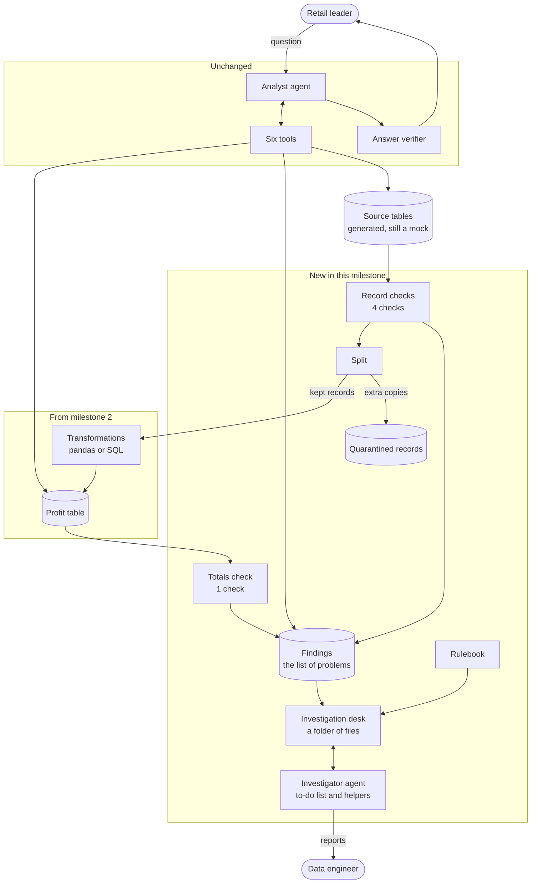

# HLD: Milestone 3, Quality and trust layer

**Status:** Approved by the learner; built
**Satisfies:** [BRD](BRD.md)

> **What this document is.** A high-level design (HLD) names the parts of the system, what each part does, and how data moves between them. Read it after the [BRD](BRD.md) and before the notebooks. The [LLD](LLD.md) then gives the exact detail of each part.

## 1. Approach

Replace one mock: the hand-written list of data problems. **Quality checks** now run on the records and produce that list.

The work has two halves:

1. **Checks, in code.** Each check looks for one kind of problem. Code applies its outcome: pass, quarantine, or needs review. No AI is involved.
2. **Investigation, by AI.** An agent reads each problem the checks found, works out the likely cause, and writes a report for a person. It only reads and writes notes. It cannot touch the data.

The six tools keep their names and arguments, and the transformations from milestone 2 are unchanged: they simply receive cleaner records. The analyst needed a few small repairs once it was asked new kinds of question; section 2 lists them.

## 2. What changed since milestone 2

| Part | Milestone 2 | Milestone 3 |
|---|---|---|
| List of data problems | Written by hand | Produced by the checks |
| Duplicated records | Counted | Set aside before the calculation |
| Quality checks | Did not exist | New: five checks, each with a fixed outcome |
| Quarantine | Did not exist | New: a table of the records that were set aside |
| Source records | Three planted problems | Seven planted problems |
| AI's work | Answering; drafting transformations | Also investigating problems and writing a report |
| Transformations and engines | Built | Unchanged |
| Quality tool | Accepts a product id | Also accepts a product's name, so a question about one product can be checked on its own |
| Analyst's instructions | Eight rules | Three sentences added: use the narrowest scope, list every finding returned, and keep the answer short (at most 15 figures) |
| Answer format | Lists must arrive as lists | A list that the model sends as text is read as a list |
| Verifier | Seven checks | An eighth: an answer that writes dollar amounts must list its figures |

## 3. Components and data flow

## 4. Component responsibilities

| Component | Responsibility | Real or mock |
|---|---|---|
| Record checks | Look at the source records and list every bad record: duplicates, missing costs, dates out of order, refunds that are too large | Real |
| Split | Divide the records into kept and quarantined, using the check results | Real |
| Quarantined records | The records that were set aside, with the reason. Never deleted | Real |
| Transformations | As milestone 2. They now run on the kept records only | Real |
| Totals check | After the calculation, confirm the profit table adds up to the kept records | Real |
| Findings | The list of problems: one row per check, product, and month, with its outcome | Real |
| Rulebook | A short document: what each check means and the usual causes of each problem | Real (written by us) |
| Investigation desk | A folder the agent works in: one file per finding, the rulebook, and a place for reports | Real |
| Investigator agent | Works through the findings on its own and writes a report for each, then a summary | Real |
| Six tools, analyst, verifier | As before. The quality tool now reads the findings | Real |
| Source tables | The business's records | Mock (generated) |

## 5. The five checks

| Check | What it looks for | Outcome when found |
|---|---|---|
| `duplicate_records` | The same record appearing more than once | Quarantine the extra copies |
| `missing_product_cost` | A product sold in a month with no cost for that month | Needs review |
| `event_out_of_order` | A refund or shipment dated before its order | Needs review |
| `refund_exceeds_line` | A refund larger than the order line it refunds | Needs review |
| `totals_do_not_match` | A total in the profit table that differs from the kept records | Needs review |

When a check finds nothing, its outcome is **pass**.

The order matters. The four record checks run first. The records are split. The transformations run on what was kept. The totals check runs last, because it needs the profit table.

## 6. Where AI is used and where it is not

| Task | Done by |
|---|---|
| Finding bad records | Code (the checks) |
| Deciding pass, quarantine, or needs review | Code, by a fixed rule per check |
| Setting records aside | Code |
| Calculating figures | Code (the transformations) |
| Reading a finding and its records, and naming the likely cause | AI agent |
| Planning the work and keeping track of it | AI agent, with a to-do list |
| Writing the report for the data engineer | AI agent |
| Checking the agent covered every finding, and scoring its causes | Code |
| Confirming a cause and fixing the data | A person |
| Answering the leader's question | The analyst agent, as before |

The investigator's reports are notes for a person. No code reads an outcome or a figure from them.

## 7. The investigator: an agent that organises its own work

In milestones 1 and 2, our code organised the agent: it gave it one question, or one task. Here the agent gets a folder and one instruction, "investigate every finding", and organises the work itself. Three ideas make that possible.

| Idea | What it means |
|---|---|
| **Files as workspace** | The agent reads and writes files in one folder, the desk. It cannot reach anything outside it |
| **To-do list** | The agent writes a list of what it must do and ticks items off. It is a tool that stores a list, so we can watch the plan |
| **Subagent (a helper)** | For each finding, the agent starts a fresh helper that handles that one finding and reports back in one line. Each helper starts clean, so one finding's detail does not crowd out the next |

Software that gives an agent these things ready-made is called a **harness**. The lab builds a small to-do list and helper by hand first, on three findings. Then it uses a ready-made harness, **Deep Agents** from LangChain, on the whole list.

## 8. Key design decisions

| Decision | Reason |
|---|---|
| Checks are code; AI only explains | A model can be wrong in a new way each time. A decision that changes the figures must be the same every time (project rule) |
| Each check is one SQL query that returns the bad records | Short enough to read and to test by hand |
| Checks run on one engine (DuckDB) | Simpler. The transformations keep both engines. A check could be moved behind the same engine interface later if data grows |
| Only certain errors are quarantined | An extra copy of a record is certainly wrong. An odd date or a large refund might be right, so a person decides |
| Quarantined records are kept in a table | Finance must be able to see what was left out |
| The totals check runs after the calculation | It is how we know no record was lost or counted twice on the way |
| The agent picks a cause from a list in the rulebook | A fixed list can be scored by code against the causes we planted |
| The agent works on copies in a folder | It cannot change the source records, the findings, or the profit table |
| A small by-hand version before the harness | Each new idea is built by hand once before a library does it |
| Only OpenRouter models | The learner's choice |

## 9. Technology

As milestone 2, with one addition: the **deepagents** package (LangChain's harness). Installing it also moves LangChain to a slightly newer version, so the tests of milestones 1 and 2 are rerun to confirm nothing changed for them.

## 10. Risks

| Risk | Handling |
|---|---|
| The agent writes somewhere it should not | Its file tools are limited to the desk folder. It has no tool to run commands or reach the network |
| The agent skips a finding, or writes a report that cannot be read | Code checks every finding has a valid report. Any that does not is marked "left for a person" |
| A long run costs more than expected | A cap on the number of findings in a run, a printed cost, and an inexpensive model chosen by a live trial |
| The agent's cause is wrong but sounds convincing | Reports are scored against the planted causes, and the lab shows the misses. The report says "likely", and a person confirms |
| A changed figure breaks milestone 1's evaluation questions | Only the trail water bottle's October figure and its category total change. The affected question is updated, and the change is recorded |
| The analyst is less reliable on new kinds of question | Found by running each new question several times. Fixed at the cause where possible (see section 2), and the verifier now catches the case that remains |
| The design is more than a beginner needs | The lab starts with finding problems by hand, then one check, before anything else |

## 11. What later milestones replace

| Mock here | Replaced in |
|---|---|
| Evidence as a sample of source rows | Milestone 4, full lineage |
| Generated source tables, and the problems planted in them | Milestone 5, ingestion |
| Problems fixed only by a person, by hand | Milestone 6, corrections and reruns |
