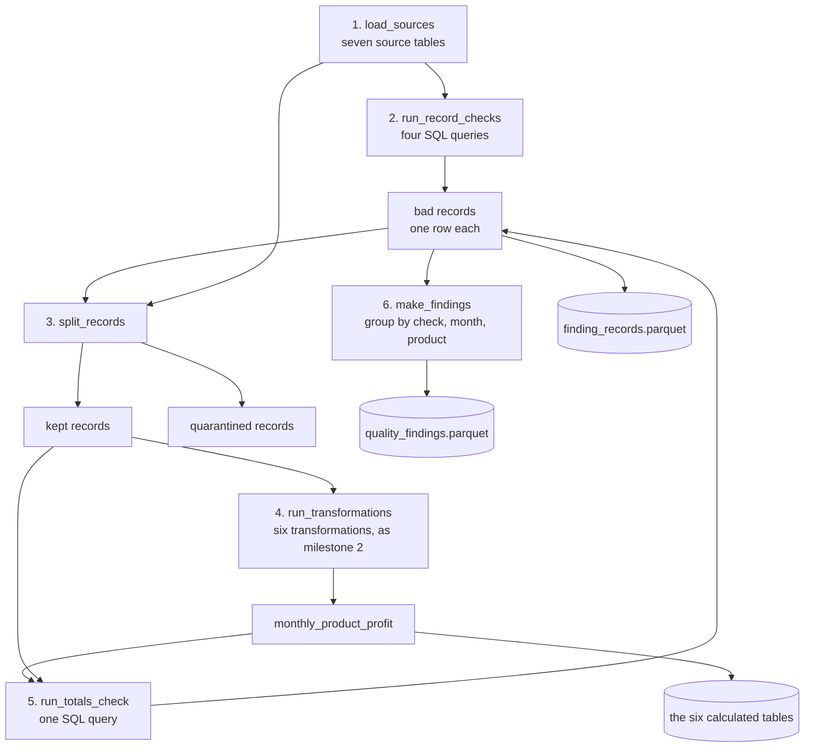

# LLD: Milestone 3, Quality and trust layer

**Status:** Approved by the learner; built
**Fits inside:** [HLD](HLD.md)

> **What this document is.** A low-level design (LLD) gives the exact detail needed to build each part named in the [HLD](HLD.md): tables, rules, functions, and tests. Keep it open beside the notebooks and the code. Section 12 tells you which notebook and which code file build each part.

Milestone 2's transformation layer is unchanged and is not repeated here: the contracts, the two engines, and the six transformations. The fixed contracts from milestone 1 are kept, with the changes listed in section 9.

## 1. Files

Everything lives inside `src/m3_quality_trust_layer/`. Nothing imports from another milestone. Files marked *new* did not exist in milestone 2.

```
docs/                             BRD.md, HLD.md, LLD.md
notebooks/                        the lab: six notebooks, lab_helpers.py, results/
data/
  source/                         generated business records, now with seven planted problems
  warehouse/                      calculated tables, plus two new quality tables
  quality_rulebook.md             new: what each check means, and the usual causes
  mock/reporting_period.json      still mocked (quality_flags.csv is gone)
retail_profit_stack/
  quality/                        new: the quality layer
    checks.py                     the five checks and the code that runs them
    sql/<check>.sql               one query per check
    quarantine.py                 splits records into kept and quarantined
    desk.py                       builds the investigation desk; reads and scores the reports
    investigate.py                builds and runs the investigator agent
  source_data.py                  changed: plants four more problems
  transform/pipeline.py           changed: runs the checks around the transformations
  store.py, tools.py, schemas.py  changed: the quality tool reads the findings
  agent.py, verify.py             changed: small repairs to the analyst (section 9)
  everything else                 as milestone 2
evals/
  m1_cases.json                   milestone 1's questions, two figures updated, three added
  m2_transform_cases.json         as milestone 2
  m3_check_cases.json             new: tiny tables that each record check must pass or fail
  m3_investigation_cases.json     new: the planted cause of each finding
tests/
milestone_3_recap.html
```

## 2. One pipeline run, step by step



`run_pipeline(engine_name=None)` does these six steps in order and writes everything to `data/warehouse/`.

## 3. Planted problems

`source_data.py` plants seven problems. The first three are milestone 2's. We know the true cause of each, because we planted it.

| # | In the records | Check that must find it | Planted cause |
|---|---|---|---|
| 1 | No cost for the camp stove (P007) in 2026-10. September has one | `missing_product_cost` | `monthly_cost_not_updated` |
| 2 | Three trail water bottle (P001) order lines in 2026-10, each appearing twice, on three different days. Their shipments and fees appear twice too | `duplicate_records` | `single_record_resent` |
| 3 | A 2026-09 refund of $60.00 on a sun hat (P011) line worth $25.00 | `refund_exceeds_line` | `amount_typed_wrong` |
| 4 | Four insulated flask (P002) order lines in 2026-10 appearing twice, all on the same day, with their shipments and fees | `duplicate_records` | `batch_loaded_twice` |
| 5 | One two-person tent (P005) refund in 2026-09 appearing twice | `duplicate_records` | `single_record_resent` |
| 6 | A hydration pack (P003) refund in 2026-10 dated 12 days before its order | `event_out_of_order` | `date_typed_wrong` |
| 7 | A rain jacket (P009) shipment in 2026-09 dated one day before its order | `event_out_of_order` | `order_recorded_late` |

Problems 4 and 5 are extra copies, and extra copies are quarantined. Problems 6 and 7 change only a date, within the same month. So the new problems do not change any figure. The only figure that moves is the trail water bottle in October (problem 2), as the BRD says.

## 4. The checks

A check is described by one small record:

```python
@dataclass(frozen=True)
class Check:
    name: str                    # for example "duplicate_records"
    looks_for: str               # one sentence, in plain words
    outcome: str                 # "quarantine" or "needs_review": what happens when it finds something
    severity: str                # "high", "medium", or "low"
    affected_metrics: tuple[str, ...]
```

Each check has one SQL file, `quality/sql/<name>.sql`. Every query returns the same columns, one row per bad record:

| Column | Meaning |
|---|---|
| `month` | The month the record counts in |
| `product_id` | The product |
| `source_table` | The table the record is in |
| `row_number` | The record's line in that table. Each source row is numbered when it is loaded, so two identical rows can be told apart |
| `detail` | One sentence saying what is wrong with this record |

| Check | Its query returns | Outcome | Severity |
|---|---|---|---|
| `duplicate_records` | Every copy after the first, in order lines, shipments, payment fees, and refunds. Two rows are copies when every column is equal | quarantine | low |
| `missing_product_cost` | One row for each product and month with sales but no row in `product_costs` | needs review | high |
| `event_out_of_order` | Each refund with `refund_date` before its order's `order_date`, and each shipment with `ship_date` before it | needs review | low |
| `refund_exceeds_line` | Each refund where `refund_amount` is more than the line's value: `quantity × unit_list_price − discount_amount` | needs review | medium |
| `totals_do_not_match` | One row for each product, month, and term where the profit table differs from the kept records. Terms checked: units sold, gross sales, discounts, refunds, return cost, fulfilment cost, shipping cost, payment fees | needs review | high |

Why these severities: a quarantined duplicate has been dealt with, so it is only a note. A missing cost or totals that do not match mean a figure is unavailable or cannot be trusted. A refund that is too large changes a figure a little. A wrong date within the month changes nothing.

Functions in `checks.py`:

```python
CHECKS: list[Check]                                   # the five, in the order above

def run_record_checks(sources) -> pd.DataFrame        # runs the first four; returns the bad records
def run_totals_check(kept, profit) -> pd.DataFrame    # runs the fifth; same columns
def make_findings(bad_records) -> pd.DataFrame        # groups bad records into findings
```

## 5. Outcomes and quarantine

`split_records(sources, bad_records)` in `quarantine.py` returns two things: the kept tables and the quarantined rows. A row is quarantined when a check whose outcome is `quarantine` listed it. Every other row is kept, including rows a `needs_review` check listed.

Three rules:

- The transformations only ever see the kept tables.
- Kept rows plus quarantined rows equal the source rows, for every table. A test proves it.
- Nothing is deleted. Quarantined rows are written to `finding_records`.

## 6. The two new tables

Both are written to `data/warehouse/` by the pipeline.

**`quality_findings`**: one row per check, month, and product where something was found.

| Column | Example |
|---|---|
| `finding_id` | `QF-002`. Numbered in a fixed order: by check (the order in section 4), then month, then product |
| `check_name` | `duplicate_records` |
| `month`, `product_id` | `2026-10`, `P001` |
| `outcome` | `quarantine` or `needs_review` |
| `severity` | `low` |
| `affected_metrics` | `units_sold;gross_sales;…` |
| `record_count` | `9` (three order lines, three shipments, three fees) |
| `description` | "Records for Trail water bottle in 2026-10 that appeared more than once: 9. The extra copies were set aside and are not in the figures." |

The description is built by code from a fixed sentence for each check. No model writes it.

**`finding_records`**: one row per bad record.

| Column | Meaning |
|---|---|
| `finding_id` | The finding it belongs to |
| `source_table`, `row_number` | Where the record is |
| `quarantined` | True if it was set aside, false if it stayed in the figures |
| `detail` | What is wrong with it |
| `record` | The whole record, as JSON text, so it can be read without the source file |

`PipelineRun` also records, for each of the five checks, `pass` or its outcome, so a check that found nothing is still reported.

## 7. The rulebook and the desk

**The rulebook** is `data/quality_rulebook.md`, written by us. For each check it gives the meaning, the outcome, and the usual causes with the sign that points to each:

| Check | Cause | The sign |
|---|---|---|
| `duplicate_records` | `batch_loaded_twice` | Several duplicates, all dated the same day |
| | `single_record_resent` | A duplicate on its own, or duplicates on different days |
| `missing_product_cost` | `monthly_cost_not_updated` | The product has a cost for the month before |
| | `product_never_costed` | The product has no cost in any month |
| `event_out_of_order` | `order_recorded_late` | The date is one day before the order |
| | `date_typed_wrong` | The date is more than one day before the order |
| `refund_exceeds_line` | `whole_order_refunded_on_one_line` | The refund equals the value of the whole order |
| | `amount_typed_wrong` | Anything else |
| `totals_do_not_match` | `calculation_lost_records` | Always this cause |

**The desk** is a folder built by `build_desk(folder, max_findings=None)` in `desk.py`:

```
desk/
  rulebook.md              a copy of the rulebook
  findings/QF-001.json     one file per finding
  reports/                 empty; the agent writes one report per finding here
  handover.md              written by the agent at the end
```

A finding file holds the finding, its bad records, and the related records a person would look up: the order for a refund or shipment, the other lines of that order, and the product's costs in other months. `max_findings` caps how many findings go on the desk, so a trial run is cheap.

**A report** is `reports/<finding_id>.json` with four fields:

| Field | Content |
|---|---|
| `finding_id` | The finding it is about |
| `likely_cause` | One cause name from the rulebook |
| `evidence` | One or two sentences: what in the records points to that cause |
| `suggested_action` | One sentence for the data engineer |

## 8. The investigator agent

Built in `investigate.py` with Deep Agents:

```python
def build_investigator(model, desk_folder)        # returns the agent
def run_investigator(agent) -> InvestigationRun   # runs it; records steps, model calls, and cost
```

| Part | Detail |
|---|---|
| Main agent's instructions | Keep a to-do list with one item per finding. Give each finding to the `investigator` helper, telling it only the finding id, and saying its report goes to `reports/<finding id>.json`. When every finding has a report, write `handover.md`: a short note for the data engineer that groups findings with the same cause |
| Helper's instructions | Investigate the one finding you are given. Read its file and the rulebook. Choose the one cause whose sign matches the records. Write the report file. Reply with one line: the finding and the cause |
| Tools | The harness's file tools (list, read, write, search), its to-do list tool, and its helper tool. We write no tools |
| Limits | File tools reach only the desk folder. No tool runs commands or uses the network. A limit on the number of steps |
| Model | The lab's default model, `anthropic/claude-haiku-5.5`. In a live trial it, `deepseek/deepseek-v4.1-flash`, and `google/gemma-4-31b-it` each got all seven causes right, for two to three US cents a run |

After the run, `read_reports(desk_folder)` in `desk.py` reads every report and returns one row per finding. `score_reports(reports)` compares `likely_cause` with the planted cause in `evals/m3_investigation_cases.json`.

| What code checks | Result |
|---|---|
| A finding has no report, the report is not valid JSON, or the cause is not in the rulebook | The finding is marked **left for a person** |
| The cause equals the planted cause | Right |
| The cause is a different rulebook cause | Wrong |

The pipeline, the tools, and the analyst never read the reports. They are for the data engineer.

**Why the main agent is told the report's file name.** The first version of its instructions left that to the helper's instructions alone. The main agent then invented a format of its own, a long `.md` file, and told each helper to use it. The first model tried scored 0 of 7, and a second produced readable reports for only three findings, because code could not read the rest. One sentence fixed it: three models then each scored 7 of 7.

**The by-hand version (lab only).** Before using the harness, notebook 4 builds the same three ideas in a few lines each, with LangChain's `create_agent` from milestone 1: a `read_file` and a `write_file` tool, a `write_todos` tool that stores a Python list, and an `investigate` tool that starts a fresh agent for one finding. It runs on three findings.

## 9. Changes to the tools, the analyst, and the fixed contracts

| Part | Change |
|---|---|
| `Store` | Loads `quality_findings` from the warehouse in place of `data/mock/quality_flags.csv` |
| `get_quality_flags` | Same name, same arguments, same result shape. It now returns the findings. `product_id` may also be a product's name, such as "sun hat". Confidence is worked out as before: the most severe finding in scope sets it (high severity gives low confidence, medium gives medium, low or none gives high) |
| `QualityFlag` | Two fields added: `outcome` and `record_count` |
| Analyst's instructions | Rule 3 now says to use the narrowest scope that covers the answer, and to list every finding any call returned. Rule 4 says every metric value in the text must also be in `figures`. A new rule limits an answer to 15 figures and a narrative of 120 words |
| `AnalystAnswer` | No field added or removed. A list field that arrives as JSON text is read as a list |
| Verifier | An eighth check, `figures_listed`: an answered question whose text gives a dollar amount must have a non-empty `figures` list |
| Analyst run | Stops after 24 steps, down from 40, so a run that goes wrong ends sooner |
| Other five tools, metric definitions | No change |

**Why the analyst changed.** The new evaluation questions ask about one product, and at first the analyst failed them about half the time. The main answer had also grown to about 4,000 tokens, because there are more findings to report. Reading the raw replies showed the causes, and each change above removes one. After the changes, in repeated live runs: the main question passed 5 of 6, E9 3 of 3, E10 2 of 3, and E8 1 of 3. The analyst is still not perfectly reliable, which is what the verifier is for.

Changes to record under "Fixed contracts":

- **Evaluation set.** In question E1 the trail water bottle's October contribution profit changes from 5188.20 to 5156.94, Hydration's total from 13358.06 to 13326.80, and Hydration's change from 376.06 to 344.80. The flag numbers are updated to the new findings. Three questions are added (below). The set grows from seven to ten.
- **Quality flags.** `QualityFlag` gains two fields.
- **Tool interface.** `get_quality_flags` accepts a product name as well as an id. The signature is unchanged.
- **Verifier.** Eight checks, up from seven.

| New question | What it tests |
|---|---|
| E8: What was the trail water bottle's contribution profit in October 2026, and how confident should I be in that figure? | The figure is 5156.94, the duplicates finding is cited, and confidence is high because the duplicates were set aside |
| E9: What were the sun hat's net sales in September 2026, and how confident should I be in that figure? | The figure is 5140.00, the oversized refund finding is cited, and confidence is medium. This is the quick ("tiny") case |
| E10: Were any records left out of the October 2026 figures, and why? | Both October duplicate findings are cited |

## 10. Check cases

`evals/m3_check_cases.json` holds tiny tables for the four record checks, written out in full, like milestone 2's hand-worked cases. Each case lists the rows its check should find. There are 15 cases.

| Check | Cases |
|---|---|
| `duplicate_records` | Clean records (nothing found); one line twice (one extra copy found); one line three times (two found); two different lines that look alike (nothing found); a refund twice |
| `missing_product_cost` | Cost present; cost missing for one month; a cancelled order needs no cost |
| `event_out_of_order` | Dates in order; refund before order; shipment before order; shipment on the same day as the order (nothing found) |
| `refund_exceeds_line` | Refund smaller than the line; refund equal to the line (nothing found); refund larger |

`run_check_case(case)` runs a case's check on its tables and says whether it found exactly the expected rows.

The totals check needs a whole profit table, so its cases are tests in code, not JSON: a correct table passes; a table with one row removed is caught; a table with one amount changed is caught; and a table calculated from all the records, copies included, is caught.

## 11. Tests

All tests run offline with no API key.

| Area | What is tested |
|---|---|
| Source data | Each of the seven planted problems is present |
| Checks | Every check passes its clean cases and finds its defect cases |
| Quarantine | Kept plus quarantined equals the source, for every table; a `needs_review` record is kept |
| Pipeline | Each planted problem produces its finding; the profit table equals milestone 2's except the trail water bottle in October; both engines still agree; running twice gives identical files |
| Tools | `get_quality_flags` returns the findings for a month, a product (by id or by name), and a category, with the right confidence |
| Desk | Each finding gets a file with its related records; the cap works |
| Reports | A good report is scored right; a wrong cause is scored wrong; a missing, unreadable, or unknown-cause report is left for a person |
| Investigator | With a scripted fake model: the agent writes a report into the desk, cannot write outside it, and cannot run a command. A model failure is recorded, not raised |
| Evaluation | The ten questions score correctly |
| Verifier | The eighth check fails an answer with dollar amounts in its text and no figures listed |
| Milestone 2's tests | Still pass, with the trail water bottle's October figure updated |
| Notebook parity | The checks written by hand in the lab find the same records as production |

## 12. Where each part is built

The lab is six notebooks, run in order. Each line of notebook code does one thing, and each helper is shown before it is used.

| Notebook | What the learner does | Documents shown | This document's sections | Production code |
|---|---|---|---|---|
| 1. Where we are, and the problems by hand | Recalls the question and the answer key. Finds three problems in the records by hand, and works out what the trail water bottle's profit should be | BRD 1, 3, 5 | 3. Planted problems | `source_data.py` |
| 2. Checks in code | Writes two checks as SQL queries, tries each on a tiny clean table and a tiny broken one, then runs all five on the real records | HLD 5 and LLD 4 | 4, 10 | `quality/checks.py`, `quality/sql/` |
| 3. Quarantine, and the figures before and after | Sets the extra copies aside, reruns the calculation, compares the figures before and after, and runs the totals check | BRD 5 and LLD 5, 6 | 2, 5, 6 | `quality/quarantine.py`, `transform/pipeline.py` |
| 4. A to-do list and a helper, by hand | Asks one model call to explain all the findings at once. Then builds file tools, a to-do list, and a helper by hand, and investigates three findings | HLD 6 | 7, 8 | `quality/desk.py` |
| 5. A harness works the queue | Gives the whole desk to a Deep Agents agent, watches every step, scores its reports against the planted causes, and reads its handover note | HLD 7 and LLD 8 | 7, 8 | `quality/investigate.py`, `quality/desk.py` |
| 6. The same question, with real warnings | Asks the analyst the leader's question, sees the warnings come from the checks, runs the new evaluation questions, and maps each notebook to its production file | LLD 12 | 9, 11 | `store.py`, `tools.py`, `agent.py`, `verify.py`, `tests/` |

Notebooks 1 to 3 make no model requests. When the lab was built, notebook 4 made about 20, notebook 5 about 40 (about three US cents), and notebook 6 about 8. A full run cost about 10 US cents.

What the live runs showed when the lab was built: one model call named all seven causes correctly; the agent built by hand got its three right; and the harness got all seven right in each of five runs, across three different models.
