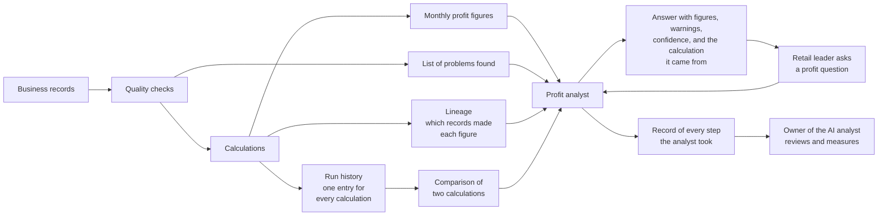

# BRD: Milestone 4, Lineage and run history

**Status:** Final; built
**Milestone:** 4 of 6 (see the project [README](../../../README.md#milestones))

> **What this document is.** A business requirements document (BRD) says what the business needs and why, in business language, with no technology. Read it first. Next, read the [HLD](HLD.md) to see what gets built to meet these needs.

## 1. Business problem

After milestone 3, Kestrel Ridge Outfitters checks its records and calculates its profit from the records that pass. The analyst gives a figure, a warning, and a confidence level.

Two things are still missing.

**Nobody can show where a figure came from.** The analyst says the trail water bottle made $5,156.94 in October. Ask "which records is that built from?" and it shows five sample records out of 754. A sample is not proof.

**Nobody can say why a figure changed.** Before milestone 3, the same figure was $5,188.20. Today it is $5,156.94. Nothing in the system recorded that it moved, when, or why. Each calculation overwrites the last one.

There is a third gap, about the AI itself. In milestone 3 the analyst sometimes failed a question, and we found that out with one-off scripts. The business has no steady way to see what the analyst did, or to measure whether a change made it better or worse.

The business needs three things:

- **Every figure can be traced** to the exact records behind it, and the trace can be proved.
- **Every calculation is kept**, so two of them can be compared and the difference explained.
- **Every answer the AI gives can be replayed and measured**: what it did step by step, how often it is right, and what its mistakes cost.

## 2. People

| Person | What they need |
|---|---|
| Retail leader | To ask "why is this number different from last week?" and get a true reason |
| Finance analyst | To see every record behind a figure, not a sample |
| Data engineer | To see what changed between two calculations: the records, the rules, or the code |
| Owner of the AI analyst | To open any answer and see each step the AI took, and to compare two versions of the analyst with numbers |
| Learner (builds the system) | To record lineage and run history, to trace an AI agent, and to run a proper evaluation |

## 3. The questions to answer

The leader's question from milestone 1 is unchanged:

> Which products and categories generated the most contribution profit last month, what changed, and how confident should I be in those numbers?

This milestone adds four questions:

1. **For finance:** where did this number come from?
2. **For the leader:** why did this number change since the last calculation?
3. **For the owner of the AI analyst:** what exactly did the analyst do to reach this answer?
4. **For the learner:** is the new analyst better than the old one, and how do we know?

## 4. Information flow (business view)

Compared with milestone 3, three things are new: lineage, run history, and the record of the analyst's steps.

## 5. Words used in this milestone

| Word | Meaning |
|---|---|
| **Run** | One calculation of all the figures, from start to finish. Each run gets an id, such as `RUN-0002` |
| **Run history** | The list of all runs, with what each one used and what it found |
| **Lineage** | The link from a figure back to the records that made it. "Lineage" means family line: a figure's parents are its records |
| **Trace** | A record of every step an AI agent took to reach one answer: what it was asked, which tools it called, what came back, how long it took, and what it cost |
| **Experiment** | Running the analyst on a fixed list of questions and scoring every answer, so two versions of the analyst can be compared |

## 6. Business rules

| Rule | Decision |
|---|---|
| Every run is kept | A new run never overwrites an old one. Each run keeps its own figures, problems, and lineage |
| What a run records | Its id, when it ran, the settings used, a fingerprint of each input and of each piece of calculation code, and what the checks found. A fingerprint is a short code worked out from a file's content: if the content changes, the fingerprint changes |
| Lineage is complete | For every figure, lineage lists every record that counted, not a sample |
| Lineage must be proved | Adding up a figure's lineage records must give the figure itself. If it does not, the run says so |
| The history we start with | Two runs. **Run 1** is how the business calculated before milestone 3: duplicated records were counted. **Run 2** is today's calculation: duplicated records are set aside. This is the real change that nobody recorded |
| What changes between those runs | Three figures. Trail water bottle, October: $5,188.20 to $5,156.94. Insulated flask, October: $2,638.14 to $2,541.35. Two-person tent, September: $2,592.24 to $2,926.24 (a duplicated refund is no longer taken off twice). Every other figure is the same |
| Every answer names its run | An answer says which run its figures came from. Code knows the run, so if the AI leaves it out, code fills it in. An answer that names a different run is rejected |
| What AI does | It explains a figure's lineage and the difference between two runs, in plain words. Every number it uses is worked out by code |
| What AI never does | It never works out a difference itself, and never guesses a reason that the comparison does not show |
| Recording the analyst's steps | Each answer's steps are sent to Langfuse, an outside service. Only fictional data is sent. The system still works when Langfuse is switched off |
| The cost of a mistake | Not every mistake costs the same. The table below gives each kind of mistake a cost. The figures are fictional and are for learning |
| Which models | Only models available through OpenRouter. Nothing is installed on the learner's computer |
| Spending | The lab must be cheap to run. The milestone's [README](../README.md) says what a full run cost when it was built |

**The cost of each kind of mistake.** An answer is charged for one mistake only. Milestone 1's verifier checks every answer before it is shown. An answer it rejects never reaches the leader, so it costs the same as no answer. The large costs are for mistakes that get past the verifier.

| Mistake | Cost | Why |
|---|---|---|
| A wrong or missing figure | $10,000 | A leader may act on a wrong number |
| Too confident: the answer says "high" when the right level is lower | $5,000 | A doubtful number is trusted |
| Answering a question that should be declined | $5,000 | An invented answer is trusted |
| A warning left out | $1,000 | The leader is not told about a known problem |
| Not confident enough: the answer says "low" when the right level is higher | $200 | Finance rechecks a number that was fine |
| No answer, or declining a question that should be answered | $200 | A person has to answer it |
| An answer the verifier rejects | $200 | It is not shown, and a person has to answer |

Being too confident costs much more than not being confident enough. That is the business's choice, and the scoring follows it.

## 7. Scope

**In scope:** a run id and a run record for every calculation; a kept copy of every run; lineage for every figure, with a proof that it adds up; a comparison of two runs; the analyst's evidence read from lineage; a new tool that compares runs; a trace of each analyst answer in Langfuse; scoring with a confusion matrix, kappa, and the cost of mistakes; two experiments compared; four new evaluation questions.

**Out of scope:** loading records from files (milestone 5); late or corrected records and safe reruns (milestone 6); tracing the calculation steps in an outside tool (milestone 6 covers run health); scheduling; dashboards; AI deciding anything about the data.

## 8. Success criteria

- Every run has an id and a record, and old runs are still there after a new one.
- For any figure, the system lists every record behind it, and those records add up to the figure.
- Comparing run 1 with run 2 shows exactly the three figures above, the setting that changed, and the records that were set aside.
- Running twice with nothing changed gives the same figures and the same fingerprints.
- The analyst answers "where did this number come from" and "why did it change" using only what the tools return, and names the run.
- Each analyst answer can be opened in Langfuse and read step by step.
- The ten evaluation questions from milestone 3 are still asked, in both experiments, so a change that makes one of them worse is seen. Four new questions test lineage and run comparison.
- Two versions of the analyst are run on the same questions, and their scores are shown side by side: how often each is right, kappa, and the cost of mistakes.

## 9. Assumptions

- All data is fictional and generated for learning.
- The evaluation set is small: 14 questions, of which 10 test the confidence level. Scores from so few questions are rough. Running each experiment more than once makes them steadier, and the lab says so.
- A real business would trace lineage column by column through many systems. Here lineage covers one calculation, which is enough to learn the idea.
