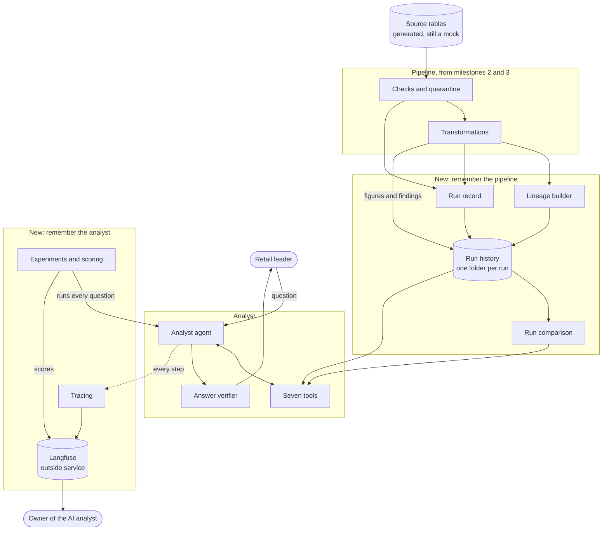

# HLD: Milestone 4, Lineage and run history

**Status:** Final; built
**Satisfies:** [BRD](BRD.md)

> **What this document is.** A high-level design (HLD) names the parts of the system, what each part does, and how data moves between them. Read it after the [BRD](BRD.md) and before the notebooks. The [LLD](LLD.md) then gives the exact detail of each part.

## 1. Approach

Replace one mock: the evidence. Until now the evidence tool put together a small sample of records each time it was asked. From this milestone it reads **lineage**: a saved table, written during the run, that links every figure to every record behind it.

The work has two halves:

1. **Remember what the pipeline did.** Each run gets an id, a record, and its own folder. Lineage is saved with it. Two runs can be compared. All of this is code, with no AI.
2. **Remember what the analyst did.** Each answer's steps are recorded as a trace. A fixed list of questions is run as an experiment and scored. This is how we know whether the analyst got better.

The two halves are the same idea applied twice: **keep a record of how a result was made, so you can explain it later.** Lineage does it for a figure. A trace does it for an answer.

## 2. What changed since milestone 3

| Part | Milestone 3 | Milestone 4 |
|---|---|---|
| Pipeline output | One set of tables, overwritten each time | One folder per run. Nothing is overwritten |
| Run record | Did not exist | New: id, time, settings, fingerprints, check results |
| Lineage | Did not exist | New: every figure linked to its records, and proved |
| Run comparison | Did not exist | New: what changed between two runs, worked out by code |
| Evidence tool | Builds a sample when asked | Reads lineage. Reports the full record counts and the run id |
| Tools | Six | Seven: `compare_runs` is new. The quality tool also returns the total of records set aside, so the analyst never adds counts up itself |
| Answer format | No run named | Names the run. Two new kinds of figure for a change between runs |
| Analyst's instructions | Nine rules | Two rules added: name the run and use lineage for "where did it come from"; use `compare_runs` for a change between runs |
| Verifier | Eight checks | Nine: the answer must name the run its figures came from |
| Evaluation questions | Ten | Fourteen |
| Watching the analyst | A tool log kept in memory | Also a list of every step with its time and cost, and a trace in Langfuse, which can be opened later |
| Measuring the analyst | Right or wrong, per question | Also a confusion matrix, kappa, and the cost of mistakes, per experiment |
| Checks, quarantine, transformations, investigator | Built | Unchanged |

## 3. Components and data flow

## 4. Component responsibilities

| Component | Responsibility | Real or mock |
|---|---|---|
| Run record | Give the run an id. Record when it ran, its settings, the fingerprint of each input file and each piece of code, and what the checks found | Real |
| Lineage builder | For each figure, list every kept record that counted, and how much it added | Real |
| Run history | A list of run records, and one folder per run holding that run's tables | Real |
| Run comparison | Take two runs. Report which settings, inputs, and code changed, which figures moved, and which records came or went | Real |
| Seven tools | Six as before, reading the latest run. The evidence tool reads lineage. `compare_runs` is new | Real |
| Analyst and verifier | As before, with two more instructions and one more check | Real |
| Tracing | Keep a list of every step of an analyst run. When switched on, also send each step to Langfuse | Real |
| Langfuse | Stores traces, question lists, and experiment results, and shows them on a website | Real (outside service) |
| Experiments and scoring | Run the analyst on every evaluation question, score each answer, and score the whole run | Real |
| Source tables | The business's records | Mock (generated) |

## 5. Lineage in one picture

A figure is made in steps. Lineage keeps both levels.

| Level | What it says | Example |
|---|---|---|
| **Steps** | Which table was made from which, by which code | `orders` and `order_items` → `sales` → `monthly_product_profit` |
| **Records** | Which records count toward one product's figures in one month, and how much each adds | An order line for 2 trail water bottles at $40.00 adds 2 units and $80.00 of gross sales to that product's October figures |

**How we know lineage is right.** Lineage that cannot be checked is only a story. So after each run, code adds up every figure's lineage records and compares the total with the figure. The trail water bottle's October gross sales must equal the sum of its 250 order lines. If any total differs, the run record says the lineage does not add up.

## 6. Two runs to compare

A history with one run has nothing to compare. So the milestone starts with two runs that tell a true story:

| Run | How it calculates | Trail water bottle, October |
|---|---|---|
| `RUN-0001` | As before milestone 3: duplicated records are counted | $5,188.20 |
| `RUN-0002` | As now: duplicated records are set aside | $5,156.94 |

The records are the same in both runs. Only one setting differs. The comparison shows that setting, the three figures that moved, and the 22 records that were set aside.

The lab also tries the other kind of change: it adds the camp stove's missing cost to a copy of the records and runs again. This time a setting did not change, but an input's fingerprint did.

## 7. Where AI is used and where it is not

| Task | Done by |
|---|---|
| Giving a run its id and record | Code |
| Building lineage, and proving it adds up | Code |
| Comparing two runs: every difference and every amount | Code |
| Explaining a figure's lineage in plain words | AI analyst |
| Explaining why a figure changed, from the comparison | AI analyst |
| Recording the analyst's steps | Code (tracing) |
| Scoring an answer, and scoring an experiment | Code |
| Choosing which version of the analyst to keep | A person, using the scores |

## 8. Langfuse, in plain words

**What it is.** Langfuse is a website and a small library. The library watches an AI agent work and sends a record of each step to the website. Think of a flight recorder for an AI agent.

**Why we need it.** An agent takes many steps: it reads the question, calls a tool, reads the result, calls another tool, and writes an answer. When an answer is wrong, the cause is in one of those steps. In milestone 3 we had to print raw replies and read them by eye. A trace keeps every step, in order, with the time and cost of each.

**The four things we use.**

| Langfuse word | What it is | Our use |
|---|---|---|
| **Trace** | Every step of one answer | Open any answer and see what the analyst did |
| **Dataset** | A stored list of questions with their correct answers | Our 14 evaluation questions |
| **Experiment** | One version of the analyst, run on every question in a dataset | "Without the run tool" and "with the run tool" |
| **Score** | A number attached to an answer or to an experiment | Right or wrong, the cost of the mistake, accuracy, kappa |

**What is sent to it.** The questions, the analyst's prompts and replies, and the tool results. All of it is fictional data. The API key for the model is never sent.

**What it costs.** Nothing. The free plan is enough for this lab.

**By hand first.** Before using Langfuse, the lab records an agent's steps with a few lines of our own code. That shows a trace is nothing more than a list of steps, each with a start, an end, an input, and an output.

## 9. Scoring an agent

Milestone 3 counted an answer as right or wrong. That hides two things: which kind of mistake was made, and what it costs.

| Measure | What it tells us |
|---|---|
| **Confusion matrix** | A table of the right confidence level against the level the analyst gave. Answers on the diagonal are right. Each cell off it is one kind of mistake |
| **Kappa** | How much better the analyst agrees with the right answers than guessing would. 1 is perfect, 0 is no better than chance. It guards against a lazy analyst that always says "high" |
| **Cost of mistakes** | Each mistake is charged the cost agreed in the BRD. One overconfident answer costs more than many cautious ones. An answer the verifier rejects is charged as no answer, because it is never shown |
| **Verified rate** | The share of answers that pass every check of the verifier, so no person has to look |
| **Model cost and time** | What the experiment cost to run, and how long it took |

## 10. The two experiments

Both run the same analyst on the same 14 questions. One thing differs.

| Experiment | Tools | What we expect, to be checked by the run |
|---|---|---|
| **Without the run tool** | Six. No `compare_runs`. Its instructions say it has no record of earlier runs | Asked why a figure changed, the analyst has no way to know. It should decline. It may guess |
| **With the run tool** | Seven | It can answer, from what the comparison returns |

The experiments also answer a second question: did adding a tool and two instructions make the old ten questions worse? In milestone 3 small additions did. Now we measure it.

## 11. Key design decisions

| Decision | Reason |
|---|---|
| One folder per run | The simplest way to keep every run. Comparing two runs is comparing two folders |
| Run ids are counted: `RUN-0001`, `RUN-0002` | Easy to read and to say. A real system would use a longer id that cannot clash |
| A fingerprint is the start of a file's SHA-256 hash | A standard, short way to tell whether a file changed |
| Lineage is one SQL query, saved as a table | It can be read, tested, and added up. It follows the same rules as the totals check from milestone 3 |
| Lineage is proved on every run | Otherwise a mistake in the lineage query would go unseen |
| The first two runs differ by one setting | It is the true history of this project, and its answer is already known |
| Code compares runs; AI only explains | A difference between two figures is a calculation, and the model never calculates (project rule) |
| One new tool, not three | Fewer tools keep the analyst steadier. The evidence tool already has the job of showing records |
| Tracing can be switched off | Tests need no network. The system must not depend on an outside service to answer |
| A trace by hand before Langfuse | Each new idea is built by hand once before a library does it |
| Scores are worked out by our code, then sent to Langfuse | The learner can read the scoring code. Langfuse stores and shows the results |
| The pipeline is not traced in Langfuse | Langfuse is built for AI steps. The run record already covers the pipeline. Run health comes in milestone 6 |

## 12. Technology

As milestone 3, with one addition: the **langfuse** package. It needs three settings in the `.env` file at the project root: `LANGFUSE_SECRET_KEY`, `LANGFUSE_PUBLIC_KEY`, and `LANGFUSE_BASE_URL`. The milestone's README says how to get them.

## 13. Risks

| Risk | Handling |
|---|---|
| The lineage query and the transformations disagree | The proof in section 5 runs on every run, and a test breaks the lineage on purpose to see it caught |
| Run folders pile up | The tables are small. A command rebuilds the two-run history from nothing |
| Langfuse is down, or the keys are missing | Tracing is off unless asked for. Notebooks that need it stop with a clear message. Tests never use it |
| Something private is sent to Langfuse | Only fictional data exists in this project. The model's API key is not part of any prompt |
| The new tool and instructions make the analyst worse on old questions | The experiments measure the old questions too. Any drop is shown, not hidden |
| Scores from 14 questions are taken too seriously | The lab says they are rough, runs experiments more than once, and reads the wrong answers one by one |
| Experiments cost more than expected | A small set of five questions is the default. The cost of every experiment is printed |
| The design is more than a beginner needs | The lab starts by tracing one figure by hand, and recording one agent's steps by hand |

## 14. What later milestones replace

| Mock here | Replaced in |
|---|---|
| Generated source tables | Milestone 5, ingestion |
| A run history built by a command | Milestone 5, where each load of files is a run |
| Figures that change only when we change a setting | Milestone 6, late and corrected records |
