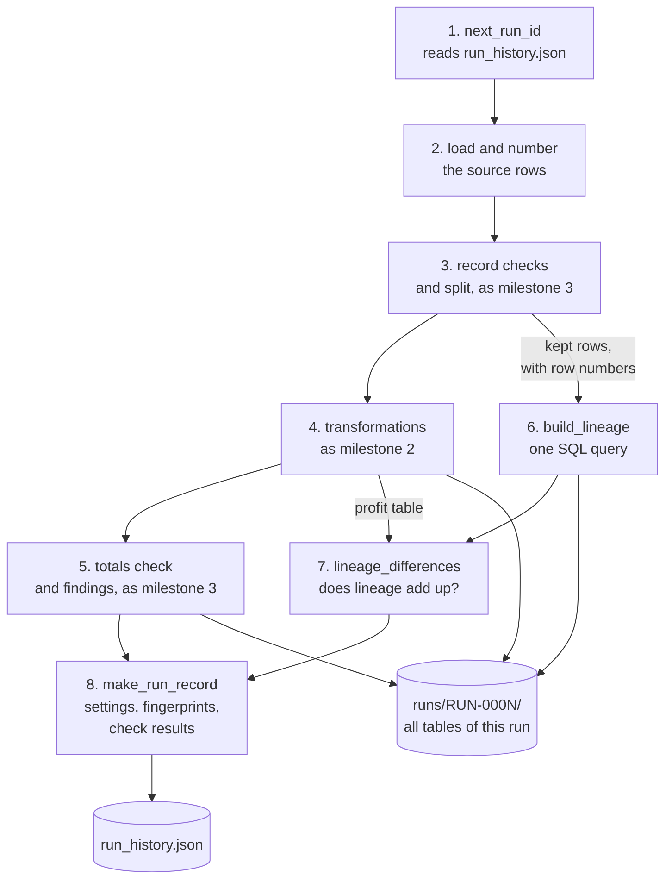

# LLD: Milestone 4, Lineage and run history

**Status:** Approved by the learner; built
**Fits inside:** [HLD](HLD.md)

> **What this document is.** A low-level design (LLD) gives the exact detail needed to build each part named in the [HLD](HLD.md): tables, rules, functions, and tests. Keep it open beside the notebooks and the code. Section 13 tells you which notebook and which code file build each part.

Milestone 3's quality layer and milestone 2's transformations are unchanged and are not repeated here. The fixed contracts from milestone 1 are kept, with the changes listed in section 8.

## 1. Files

Everything lives inside `src/m4_lineage_run_history/`. Nothing imports from another milestone. Files marked *new* did not exist in milestone 3.

```
docs/                             BRD.md, HLD.md, LLD.md
notebooks/                        the lab: seven notebooks, lab_helpers.py, results/
                                  (the lab keeps its own runs in notebooks/lab_warehouse/)
data/
  source/                         generated business records, as milestone 3
  warehouse/
    run_history.json              new: one entry per run
    runs/RUN-0001/ ...            new: one folder per run, holding that run's tables
retail_profit_stack/
  lineage/                        new: remember the pipeline
    runs.py                       run ids, fingerprints, run records, the history file
    lineage.py                    builds lineage and proves it adds up
    sql/figure_lineage.sql        the lineage query
    compare.py                    compares two runs
  make_history.py                 new: builds the two runs the milestone starts with
  tracing.py                      new: records an analyst run's steps; optional Langfuse tracing
  scoring.py                      new: confusion matrix, kappa, cost of mistakes
  experiments.py                  new: runs an experiment in Langfuse
  transform/pipeline.py           changed: writes a run folder, a run record, and lineage
  store.py, tools.py, schemas.py  changed: read one run; evidence from lineage; compare_runs
  agent.py, verify.py             changed: two instructions, one check (section 8)
  evaluation.py                   changed: four new questions, two new checks
  everything else                 as milestone 3
evals/
  m1_cases.json                   the evaluation questions: ten from before, four added
  other files                     as milestone 3
tests/
milestone_4_recap.html
```

## 2. One pipeline run, step by step



`run_pipeline(engine_name=None, source_dir=..., warehouse_dir=..., quarantine=True, note="")` does these eight steps. Steps 2 to 5 are milestone 3's. The new argument `quarantine=False` counts every record, the way the business calculated before milestone 3. `note` is one sentence, written by the person who started the run, saying why.

## 3. Run records

**Run id.** `RUN-` and a four-digit number. `next_run_id` reads the history file and adds one to the last number. The first run is `RUN-0001`.

**Fingerprint.** The first 12 characters of the SHA-256 hash of a file's bytes. The same file always gives the same fingerprint. Change one character and it changes.

```python
def fingerprint(file: Path) -> str
```

**The run record** is one entry in `data/warehouse/run_history.json`:

| Field | Example | Meaning |
|---|---|---|
| `run_id` | `RUN-0002` | |
| `started_at` | `2026-11-15T10:42:07` | When the run began |
| `note` | "Duplicated records are set aside" | Why the run was made |
| `settings` | `{"engine": "sql", "quarantine": true}` | The choices that can change the figures |
| `metric_version` | `1.0.0` | The version of the metric definitions |
| `inputs` | `{"order_items": {"rows": 2549, "fingerprint": "3f9a…"}, …}` | One entry per source table |
| `code` | `{"sales": "b21c…", "duplicate_records": "77e0…", …}` | The fingerprint of each transformation file and each check file |
| `check_outcomes` | `{"duplicate_records": "quarantine", …}` | As milestone 3 |
| `findings` | `7` | How many findings |
| `quarantined` | `{"order_items": 7, "refunds": 1, …}` | Rows set aside, by table |
| `lineage_adds_up` | `true` | The result of the proof in section 4 |
| `seconds` | `0.8` | How long the run took |

Functions in `runs.py`:

```python
def next_run_id(warehouse_dir) -> str
def save_run_record(record, warehouse_dir) -> None       # adds it to run_history.json
def read_history(warehouse_dir) -> list[dict]            # oldest first
def read_run_record(run_id, warehouse_dir) -> dict
def latest_run_id(warehouse_dir) -> str | None
def run_folder(run_id, warehouse_dir) -> Path
def input_fingerprints(source_dir, row_counts) -> dict   # rows and fingerprint per source table
def code_fingerprints(code_files) -> dict                # fingerprint per code file
```

The record itself is put together at the end of `run_pipeline`, in plain view.

**With quarantine off**, nothing is set aside. So a check whose outcome would be `quarantine` is recorded as `needs_review`, and its finding says the extra copies are still counted.

**The run folder** `data/warehouse/runs/<run_id>/` holds the six calculated tables, `quality_findings`, and `finding_records`, as milestone 3 wrote them, plus the two lineage tables below.

**What is the same and what differs between two runs with nothing changed.** The tables and every fingerprint are identical. Only `run_id`, `started_at`, and `seconds` differ. A test proves it.

## 4. Lineage

**`lineage_steps`**: one row for each input of each transformation. It comes from the transformation list of milestone 2. No query is needed.

| Column | Example |
|---|---|
| `output_table` | `sales` |
| `input_table` | `order_items` |
| `code_fingerprint` | `b21c…` |

**`figure_lineage`**: one row for each kept record and each term it adds to.

| Column | Example | Meaning |
|---|---|---|
| `month`, `product_id` | `2026-10`, `P001` | The figure's row in the profit table |
| `term` | `gross_sales` | The part of the figure this record adds to |
| `source_table`, `row_number` | `order_items`, `1204` | Where the record is. Row numbers were added in milestone 3 |
| `record_id` | the order line's id | The record's own id |
| `amount` | `80.00` | How much the record adds to the term |

Which records add to which term, and in which month. These are the same rules the transformations and the totals check use:

| Source table | Terms | Month taken from | Left out |
|---|---|---|---|
| `order_items` | `units_sold`, `gross_sales`, `discounts` | The order's date | Lines of cancelled orders |
| `refunds` | `refunds`, `return_cost` | The refund's date | |
| `shipments` | `fulfillment_cost`, `shipping_cost` | The shipping date | |
| `payment_fees` | `payment_fees` | The capture date | |
| `product_costs` | `product_cost` | The cost's month | Its amount is the unit cost times the units sold |

Only kept records appear. A quarantined record is in `finding_records`, with its finding, and not in lineage. `RUN-0002`'s lineage has 15,229 rows for 7,626 records.

**From terms to metrics.** A metric is made of terms, each added or taken away:

```python
METRIC_TERMS = {
    "net_sales": {"gross_sales": +1, "discounts": -1, "refunds": -1},
    "gross_profit": {"net_sales": +1, "product_cost": -1},
    "contribution_profit": {
        "gross_profit": +1,
        "fulfillment_cost": -1,
        "shipping_cost": -1,
        "payment_fees": -1,
        "return_cost": -1,
    },
}
```

So the records behind the trail water bottle's October contribution profit are all its lineage rows: 250 order lines, 3 refunds, 250 shipments, 250 payment fees, and 1 cost. That is 754 records.

**The proof.**

```python
def lineage_steps(code) -> pd.DataFrame                      # the first level
def build_lineage(kept_numbered_tables) -> pd.DataFrame      # runs sql/figure_lineage.sql
def lineage_differences(lineage, profit) -> pd.DataFrame     # empty when lineage adds up
def record_counts(lineage, month, product_id) -> dict        # records behind one figure, by table
```

`lineage_differences` adds up `amount` for each month, product, and term, and compares it with the profit table. It returns every total that differs by more than half a cent. An empty result means lineage adds up, and the run record says `lineage_adds_up: true`.

## 5. Comparing two runs

```python
def compare_runs(earlier_id, later_id, warehouse_dir) -> dict
```

It reads the two run records and the two run folders, and returns:

| Part | Content |
|---|---|
| `settings_changed` | Each setting that differs, with its value in each run |
| `inputs_changed` | Each source table whose fingerprint differs, with its row count in each run |
| `code_changed` | Each transformation or check whose fingerprint differs |
| `checks_changed` | Each check whose outcome differs |
| `figures_changed` | One row per month, product, and metric whose value differs: the value in each run, and the change |
| `records_changed` | For each month and product with a changed figure: how many lineage records were only in the earlier run, and how many only in the later run, by source table |
| `findings` | For each of those months and products: the findings in each run, so a change can be tied to the check that caused it |

Everything is subtraction and set difference on saved tables. No model is involved.

**The two runs the milestone starts with.** `make_history.py` clears `data/warehouse/` and makes them:

| Run | Call | Note |
|---|---|---|
| `RUN-0001` | `run_pipeline(quarantine=False)` | "Duplicated records are counted, as before milestone 3" |
| `RUN-0002` | `run_pipeline()` | "Duplicated records are set aside" |

Comparing them gives one changed setting (`quarantine`: false to true), no changed inputs, no changed code, and these changed figures:

| Month | Product | Contribution profit, `RUN-0001` | `RUN-0002` | Change | Records no longer counted |
|---|---|---|---|---|---|
| 2026-09 | Two-person tent (P005) | 2,592.24 | 2,926.24 | +334.00 | 1 refund |
| 2026-10 | Trail water bottle (P001) | 5,188.20 | 5,156.94 | −31.26 | 3 order lines, 3 shipments, 3 fees |
| 2026-10 | Insulated flask (P002) | 2,638.14 | 2,541.35 | −96.79 | 4 order lines, 4 shipments, 4 fees |

Net sales and gross profit change for the same three rows. The tent's profit goes up, because a refund that was taken off twice is now taken off once.

## 6. The tools

The tools read one run. `Store(run_id=None)` loads the latest run's folder when no run is named.

| Tool | Change |
|---|---|
| `get_reporting_period`, `get_metric_definition` | None |
| `query_profit`, `compare_profit` | Same arguments. The result gains one field, `run_id` |
| `get_quality_flags` | Same arguments. The result gains `run_id` and `set_aside_count`: the total of records set aside across the flags returned. Without that total, the analyst added the counts up itself, which rule 1 forbids and the verifier rejects |
| `get_evidence(month, product_id, limit=5)` | Same arguments, and `product_id` may now be a product's name. It now reads `figure_lineage`. The result gains `run_id`, `record_counts` (every record behind the figures, by source table), `set_aside_count` (records quarantined for this product and month), and `steps` (the tables the figure passed through). `records` is still limited to `limit`, most notable first, so the reply stays short |
| `compare_runs(month=None, product_id=None, metric="contribution_profit")` | New. Compares the latest run with the one before it, and returns section 5's result for one metric, for the month and product asked about. `product_id` may be a product's name. With no month and no product it covers every figure. When a product is named and its figure did not change, the figure is still returned, under `figures_unchanged`, so the analyst can say "no change" with a number |

`compare_runs` returns an error sentence, not an exception, when the history has only one run.

## 7. Tracing

A trace is a list of steps, each with a start, an end, an input, and an output. `tracing.py` produces one in two ways.

| Part | What it does |
|---|---|
| `StepRecorder` | Keeps a list of every model call and tool call of one analyst run, in memory, with the seconds, tokens, and cost of each. It is always on, and needs no network |
| `langfuse_handler()` | Returns Langfuse's own handler, which sends the same steps to Langfuse. Used only when tracing is asked for |
| `trace_labels(run_id, name)` | The labels Langfuse shows on a trace. One of them is the pipeline run's id |
| `langfuse_ready()` | True when the three Langfuse settings are present |

Both are **callback handlers**: objects with methods that LangChain calls by itself when a model call or a tool call starts and ends.

`run_analyst(question, model=None, store=None, trace=False, run_tool=True)`:

| Argument | Meaning |
|---|---|
| `trace` | When true, the steps are also sent to Langfuse. Off by default, so tests and offline use need nothing |
| `run_tool` | When false, the analyst gets six tools, without `compare_runs`, and is told it has no record of earlier runs. Used by the first experiment |

`AnalystRun` gains four fields: `run_id` (the pipeline run the tools read), `steps` (the recorder's list), `cost` (the model cost of the run in US dollars, added up from the steps), and `trace_id` (empty when tracing is off).

So the chain from an answer back to the records is: answer → `trace_id` → `run_id` → `figure_lineage` → source records.

**The by-hand version (lab only).** Notebook 5 writes a small handler of its own, about twenty lines, that adds one line to a list for each step. Printing the list is the trace. `StepRecorder` is the production form of it.

## 8. Changes to the analyst and the fixed contracts

| Part | Change |
|---|---|
| Analyst's instructions | Rule 10 added: set `run_id` to the `run_id` the tools returned; when asked where a figure came from, call `query_profit` for the figure and `get_evidence` for the records. Rule 11 added: for a change between runs, call `compare_runs` and give only the reasons it shows; if it shows none, say the reason is not recorded. Without the run tool, rule 11 says to decline such a question |
| `AnalystAnswer` | One field added: `run_id`. If the model leaves it empty, code fills it in, because code knows which run the tools read |
| `QualityResult` | One field added: `set_aside_count` |
| `Figure.kind` | Two values added: `earlier_run_value` (a figure as it was in the run before) and `run_change` (later run minus earlier run) |
| Verifier | The figures check also accepts values returned by `compare_runs`. A ninth check, `run_cited`: an answer with figures must name the run the tools read. An answer that names another run fails |
| Tools | Seven, up from six |
| Evaluation set | Fourteen questions, up from ten |

Changes to record under "Fixed contracts": the tool interface gains `compare_runs`; four tool results gain `run_id`; the evidence result gains three more fields and the quality result one; `get_evidence` accepts a product name; the answer format gains `run_id` and two figure kinds; the verifier has nine checks; the evaluation set has fourteen questions.

**What the first live runs showed.** The new questions failed at first for two plain reasons, both found by reading the failed checks. The comparison did not return the metric's version, so the analyst could not state it. And asked where a figure came from, the analyst fetched the records and forgot the figure. One field and one sentence fixed them. An older question, E10, failed because the analyst added two record counts together itself; returning the total from the tool fixed that.

| New question | What it tests |
|---|---|
| E11: Where did the trail water bottle's October 2026 contribution profit come from? | The figure is 5156.94. The evidence tool was called for that product and month. `RUN-0002` is named. Finding QF-002 is cited |
| E12: Why did the trail water bottle's October 2026 contribution profit change since the last run? | Three figures: 5188.20 before, 5156.94 now, a change of −31.26. `compare_runs` was called. QF-002 is cited. This is a quick ("tiny") case |
| E13: Which products' contribution profit changed between the last two runs? | The three changes in section 5, and no others |
| E14: Did the sun hat's September 2026 net sales change since the last run? | The figure is 5140.00, and the answer reports no change. Confidence is medium, because of the oversized refund |

Two checks are added to the scoring of a question: `expected_tools` (each named tool appears in the tool log) and `expected_run` (the answer's `run_id`). The quick ("tiny") set is now five questions: E1, E2, E6, E9, and E12.

## 9. Scoring

`scoring.py` holds plain functions. None of them needs a model or Langfuse.

**The level of an answer.** For scoring, every answer has one level: `high`, `medium`, `low`, or `declined`. A run with no answer counts as `declined`. An answer with no confidence stated counts as `high`: an answer with no word of doubt is read as fully trusted.

Ten of the fourteen questions have a right level: four `high`, two `medium`, two `low`, and two `declined`. The other four (E3, E5, E10, E13) do not test the level, because a correct answer could be given at more than one. They are left out of the confusion matrix and of kappa, and are still scored right or wrong.

```python
LEVELS = ["high", "medium", "low", "declined"]

def right_level(case) -> str | None          # None when the question does not test the level
def answer_level(run) -> str
def mistake(case, run, score) -> str         # the name of the mistake charged, or "none"
def score_row(case, run, score) -> dict      # one row of the score table
def confusion_matrix(table) -> pd.DataFrame
def kappa(table) -> float
def run_scores(table) -> dict                # the scores of a whole experiment
```

**The cost of mistakes**, as agreed in the BRD. The first row that applies is charged:

| Order | Mistake | How code detects it | Cost |
|---|---|---|---|
| 1 | Answered when it should decline | The right level is `declined`, and the answer is not | 5,000 |
| 2 | No answer, or a wrong decline | The answer is `declined`, and the right level is not | 200 |
| 3 | Stopped by the verifier | The answer failed one of the verifier's nine checks | 200 |
| 4 | Wrong or missing figure | The question's expected figures are not all in the answer | 10,000 |
| 5 | Too confident | The answer's level is higher than the right level | 5,000 |
| 6 | Warning left out | The question's expected flags are not all cited | 1,000 |
| 7 | Not confident enough | The answer's level is lower than the right level | 200 |
| 8 | Any other failed check | For example, the expected tool was not called | 100 |

Row 3 is why the verifier matters. An answer it rejects is never shown to the leader, so it costs what a missing answer costs. Rows 4 to 6 are the mistakes that got past it.

**Kappa**, in three lines:

- *Observed*: the share of questions where the analyst's level equals the right level.
- *By chance*: for each level, the share of questions where it is right, times the share where the analyst chose it. Add these up.
- *Kappa* = (observed − by chance) ÷ (1 − by chance).

Worked example: of the 10 questions with a right level, 4 are `high`. An analyst that always says `high` is right on 4 of 10, which is 40%. By chance it is also 40%, because it says `high` every time and `high` is right 40% of the time. Kappa is 0: no better than guessing.

**The scores of an experiment** (`run_scores`):

| Score | Meaning |
|---|---|
| `accuracy` | Share of questions that passed every check |
| `level_accuracy` | Share of questions on the diagonal of the confusion matrix |
| `kappa` | As above |
| `cost_of_mistakes` | The sum of `mistake_cost` |
| `verified_rate` | Share of answers that passed all nine checks of the verifier |
| `model_cost`, `seconds` | What the experiment cost, and how long it took |

## 10. Experiments

`experiments.py` is the only file that talks to Langfuse about datasets and experiments.

```python
DATASET = "profit-questions"

def upload_questions(cases) -> None
def answer_and_score(case, run_tool, trace=True) -> dict     # one question: ask, score, one row
def run_experiment(name, description, cases, run_tool, times=1) -> pd.DataFrame
```

| Step | Detail |
|---|---|
| `upload_questions` | Creates the dataset and one item per question. The item's id is the question's id, so uploading again updates the items and adds none |
| The task | For one item: `answer_and_score`. It calls `run_analyst(question, trace=True, run_tool=...)`, scores the answer with `score_case`, and returns the row from `score_row` |
| The item evaluator | Reads that row and sends two scores to Langfuse: `right` and `mistake_cost` |
| One at a time | Langfuse runs the questions one after another, so the output is easy to follow |
| The run evaluator | Sends the scores of section 9 for the whole experiment |
| `times` | How many times to run the experiment. Answers vary from run to run, so more runs give steadier scores |
| What comes back | The score table of section 9, with one more column, `repeat` |

The two experiments of HLD section 10 are two calls: `run_tool=False` and `run_tool=True`.

A cell in the last notebook, off by default, deletes every trace in the learner's Langfuse project and the items of this dataset. It is for a project made only for this lab.

## 11. Planted problems and check cases

Unchanged from milestone 3: seven planted problems, five checks, fifteen check cases.

## 12. Tests

All tests run offline with no API key and no Langfuse.

| Area | What is tested |
|---|---|
| Fingerprint | The same file gives the same fingerprint; one changed character gives a different one |
| Run ids and history | The first id is `RUN-0001`; each run adds one entry; an earlier run's folder is untouched by a later run |
| Run record | It holds every field of section 3; two runs with nothing changed have equal tables and fingerprints |
| Lineage | It adds up for every month, product, and term; no quarantined record is in it; the trail water bottle in October has the 754 records of section 4 |
| Lineage proof | A lineage table with one row removed is caught, and so is one with a changed amount |
| Metric terms | Applying `METRIC_TERMS` to the profit table gives each metric |
| Run comparison | `RUN-0001` against `RUN-0002` gives one changed setting and exactly the three changed figures of section 5. A run compared with itself gives no changes. Adding the camp stove's cost changes one input fingerprint and makes its October profit available |
| Tools | `get_evidence` returns the full record counts and the run id; `compare_runs` works for a month, a product by id or by name, and with no arguments; with one run it returns an error sentence |
| Store | It loads the latest run by default, and a named run when asked |
| Verifier | The ninth check passes an answer that names the right run and fails one that names none or another |
| Evaluation | The fourteen questions score correctly |
| Scoring | Every row of the cost table; kappa is 1 for a perfect analyst and 0 for one that always says `high`; the confusion matrix and the run scores |
| Analyst | With a scripted fake model: a run records its steps and its pipeline run; with `run_tool=False` the analyst has six tools; with tracing off no trace id is set; a missing `run_id` is filled in, and a wrong one fails |
| Milestone 3's tests | Still pass |
| Notebook parity | The fingerprint, lineage, comparison, and scoring written by hand in the lab agree with production |

## 13. Where each part is built

The lab is seven notebooks, run in order. Each line of notebook code does one thing, and each helper is shown before it is used.

| Notebook | What the learner does | Documents shown | This document's sections | Production code |
|---|---|---|---|---|
| 1. A figure, traced by hand | Recalls the question and the answer key. Takes $5,156.94 and finds every record behind it by hand. Adds them up and gets the figure. Sees that the old figure, $5,188.20, is recorded nowhere | BRD 1, 3 | 4 | none |
| 2. Run records | Works out a fingerprint by hand and changes one character. Builds a run record. Runs the pipeline twice, the old way and the new way, and reads the history | BRD 5, 6 and LLD 3 | 2, 3 | `lineage/runs.py`, `transform/pipeline.py`, `make_history.py` |
| 3. Lineage | Writes the lineage for order lines as one query, then uses the full query. Proves it adds up. Breaks it on purpose and sees the proof fail | HLD 5 and LLD 4 | 4 | `lineage/lineage.py`, `lineage/sql/` |
| 4. Two runs compared | Compares the two runs step by step: settings, fingerprints, figures, records. Then adds the missing cost to a copy of the records, runs again, and compares | HLD 6 and LLD 5 | 5 | `lineage/compare.py` |
| 5. A trace of the analyst | Asks one model call why the figure changed, with only the two figures to go on. Gives the analyst the new tools. Records its steps by hand. Then switches Langfuse on and opens the trace | HLD 7, 8 and LLD 6, 7 | 6, 7, 8 | `tools.py`, `agent.py`, `tracing.py`, `verify.py` |
| 6. Scoring an agent | Builds the confusion matrix, kappa, and the cost of mistakes by hand, on three made-up analysts: one always says "high", one always declines, one is perfect | BRD 6 and HLD 9 | 9 | `scoring.py` |
| 7. Two experiments | Uploads the questions to Langfuse. Runs the analyst without and with the run tool. Compares the scores, reads the wrong answers, and maps each notebook to its production file | HLD 10 and LLD 10 | 10, 12 | `experiments.py`, `evaluation.py`, `tests/` |

Notebooks 1 to 4 and 6 make no model requests. Notebooks 5 and 7 need the OpenRouter key and the three Langfuse settings. When the lab was built, notebook 5 made about 15 requests and notebook 7 about 40, with five questions per experiment. A full run of the lab cost about 5 US cents. One experiment on all fourteen questions cost about 3 US cents and took about a minute and a half.

**What the live runs showed when the lab was built.** Each experiment was run twice on all fourteen questions, so each has 28 answers.

| | Without the run tool | With the run tool |
|---|---|---|
| Answers right | 22 of 28 | 25 of 28 |
| The three "since the last run" questions | 0 of 6: it declined every time | 6 of 6 |
| The ten older questions | 20 of 20 | 17 of 20 |
| Kappa (each run) | 0.73 and 0.73 | 0.87 and 1.00 |
| Cost of mistakes (both runs) | $1,200 | $600 |

How to read this:

- The new tool does what it was added for. Without it the analyst declined all three questions about a change between runs, which is the honest answer and costs $200 each.
- The older questions did slightly worse with the tool: one question (E8) failed twice because the analyst checked the whole month's warnings where one product's would do, and so gave a lower confidence. Three answers out of twenty is too few to be sure the tool caused it. It is the kind of thing an experiment is for, and the lab's first assignment asks the learner to look at it.
- Every wrong answer cost $200. None cost $5,000 or $10,000, because the verifier stopped the ones that would have.
- These are small numbers. One answer moves a score by several points.

An earlier full run found two weaknesses that are older than this milestone, and reading the failed answers showed the cause of each. The camp stove question (E4) failed most of the time, in milestone 3's code too: the analyst wrote the net sales definition's version as "unknown", because nothing said that a result's `metric_version` covers every term in it. One sentence in rule 5 and one in the tool's description fixed it. And the verifier wrongly failed a correctly declined answer when the analyst had looked at the warnings before declining; a declined answer no longer has to list them.
