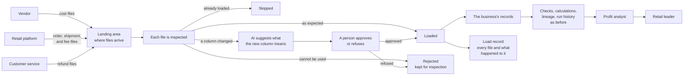

# BRD: Milestone 5, Raw data and ingestion

**Status:** Approved by the learner; built
**Milestone:** 5 of 6 (see the project [README](../../../README.md#milestones))

> **What this document is.** A business requirements document (BRD) says what the business needs and why, in business language, with no technology. Read it first. Next, read the [HLD](HLD.md) to see what gets built to meet these needs.

## 1. Business problem

After milestone 4, Kestrel Ridge Outfitters checks its records, calculates profit, traces every figure, and keeps every calculation. One thing is still pretend: **how the records get in.**

Until now the records were seven complete tables that simply existed. A real business does not work like that. Its systems send **files**: this week's orders, this week's shipments, this month's product costs. The files keep coming, and three things go wrong with them.

- **A file arrives twice.** A system resends Monday's file. If it is loaded twice, every order in it is counted twice.
- **A file's columns change.** The platform is upgraded and `unit_list_price` becomes `list_price`. A loader that expects the old name stops, or worse, loads nothing and says nothing.
- **A load stops halfway.** The computer restarts in the middle of forty files. Which ones were loaded? Starting again from the top would load some of them twice.

The business needs four things:

- **Loading is repeatable.** Loading the same file twice changes nothing.
- **A changed file is noticed** and handled by a fixed rule. It never crashes the load and never loses data quietly.
- **A person approves any guess about a changed column** before it is used. AI may make the guess. A person must agree.
- **A load can stop and carry on**, whether it stops for a crash or to wait for that person.

## 2. People

| Person | What they need |
|---|---|
| Retail leader | The same profit answer as before, now from records that were really loaded |
| Finance analyst | To know every file that was loaded, skipped, or rejected, and why |
| Data engineer | To be asked only when a file really needs a decision, and not to be woken when a load can simply carry on |
| Learner (builds the system) | To build a loader that is safe to repeat, to pause an AI workflow for a person's approval, and to run many AI agents side by side |

## 3. The questions to answer

The leader's question from milestone 1 is unchanged:

> Which products and categories generated the most contribution profit last month, what changed, and how confident should I be in those numbers?

This milestone adds four questions:

1. **For finance:** which files went into these figures, and which were left out?
2. **For the data engineer:** this file has changed. What does its new column mean?
3. **For the learner:** can an AI workflow wait hours for a person, survive a crash, and never do the same thing twice?
4. **For the learner:** when forty files arrive at once, can many AI agents work on them side by side, and what does that cost?

## 4. Information flow (business view)

Compared with milestone 4, the records are no longer simply there. They are built up, file by file, and every file's fate is written down.

## 5. Words used in this milestone

| Word | Meaning |
|---|---|
| **Ingestion** | Bringing data from outside into the system. Here: loading files into the business's records |
| **Landing area** | The folder where files arrive, before anything has looked at them |
| **Feed** | One kind of file that keeps arriving, such as the weekly order files |
| **Mapping** | A statement that a column in a file means a column we expect. For example: `list_price` means `unit_list_price` |
| **Load record** | A list of every file seen, with what happened to it and when. Also called a ledger |
| **Durable** | Saved somewhere that survives a crash. A durable workflow can stop and carry on later |

## 6. Business rules agreed with the learner

| Rule | Decision |
|---|---|
| How files arrive | Orders, order lines, refunds, shipments, and payment fees arrive as one file per week. Product costs arrive as one file per month. The product list arrives once |
| The same file again | A file whose content was already loaded is skipped. This is decided by the file's content, not its name |
| The same record in two different files | Not the loader's job. The duplicate check from milestone 3 finds it, as before |
| Columns in a different order | Loaded. Columns are matched by name |
| An extra column | Loaded. The extra column is ignored, and the load record says so |
| A column missing, with nothing new in its place | Rejected. The file is kept for inspection and the sender must send a complete one |
| A column missing, with an unknown column present | The file may have been renamed. AI suggests a mapping, and a person approves or refuses it |
| Who decides a mapping | A person, always. AI only suggests. Code applies an approved mapping and checks the result |
| An approved mapping | It is saved. The next file from the same feed with the same change loads without asking again |
| A refused mapping | The file is rejected |
| Values that do not fit after loading | Rejected. For example, a price column holding text |
| A file with a name already loaded, and different content | Rejected for now. Handling a corrected file is milestone 6 |
| A rejected file | Never deleted. It stays in the load record with the reason |
| A load that stops | It carries on from where it stopped. Nothing is loaded twice |
| The figures | Every profit figure, finding, and lineage count equals milestone 4's. Only the way the records arrive has changed |
| Which models | Only models available through OpenRouter. Nothing is installed on the learner's computer |
| Where the workflow's state is saved | In a file on the learner's computer. The learner chose this over a hosted database, so no new account is needed |
| Spending | The learner set a limit of $2 of OpenRouter credit for building this milestone |

## 7. Scope

**In scope:** a generator that writes dated files; a few file problems planted in them; a loader that is safe to repeat; a load record; fixed rules for changed columns; an AI agent that suggests mappings; a pause for a person's approval; saved mappings; a load that survives a crash; a dispatcher that loads many files side by side; scoring the AI's suggestions; the pipeline of milestones 2 to 4 running on the loaded records.

**Out of scope:** a corrected version of a file that was already loaded, and records that arrive late (milestone 6); reporting an unreplaced rejected file as a data quality finding (milestone 6); real outside systems; streaming; cloud storage; scheduling; AI deciding a mapping by itself.

## 8. Success criteria

- The same seed gives the same files, every time.
- Loading the files twice gives exactly the same records as loading them once.
- Each planted file problem meets its rule: the resent file is skipped, the reordered and extra-column files load, the incomplete file is rejected, and each renamed file waits for approval.
- No renamed file is loaded until a person has approved its mapping.
- A load that is stopped partway carries on and ends with the same records as an uninterrupted load.
- Loading many files at once gives the same records as loading them one at a time.
- Every file seen is in the load record with its outcome.
- The profit figures, findings, and lineage counts equal milestone 4's, and the fourteen evaluation questions are still asked.
- The AI's suggested mappings are scored against the changes we planted, and the score is shown.

## 9. Assumptions

- All data is fictional and generated for learning.
- We planted the column changes, so we know the true meaning of each. That lets us score the AI. In real work a person confirms a mapping, often by asking the sender.
- About fifty files are enough to learn the pattern. A real business loads thousands a day.
