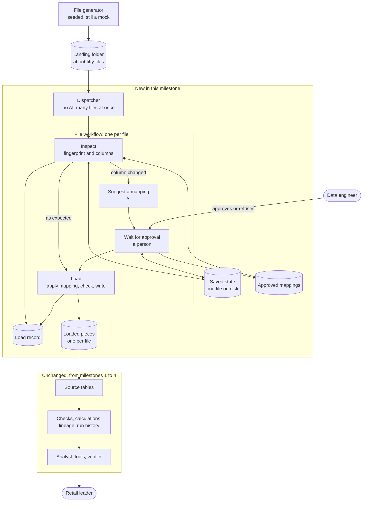

# HLD: Milestone 5, Raw data and ingestion

**Status:** Approved by the learner; built
**Satisfies:** [BRD](BRD.md)

> **What this document is.** A high-level design (HLD) names the parts of the system, what each part does, and how data moves between them. Read it after the [BRD](BRD.md) and before the notebooks. The [LLD](LLD.md) then gives the exact detail of each part.

## 1. Approach

Replace one mock: the ready-made source tables. The generator now writes **files** into a landing folder, and a **loader** builds the business's records from them.

The work has three parts:

1. **A loader that is safe to repeat, in code.** It fingerprints each file, checks its columns against the contract, applies a fixed rule, and writes down what it did. No AI.
2. **A workflow that can wait.** When a column has changed, AI suggests a mapping, the workflow pauses, and a person approves. The workflow's state is saved after every step, so it survives a wait or a crash.
3. **Many files at once.** A dispatcher hands the files to workers that run side by side, with a cap and a retry.

Everything above the source tables is unchanged: the checks, the calculations, lineage, run history, the seven tools, the analyst, and the verifier.

## 2. What changed since milestone 4

| Part | Milestone 4 | Milestone 5 |
|---|---|---|
| The generator | Writes seven complete tables | Writes about fifty dated files, with file problems planted in them |
| Source tables | Read straight from the generator's output | Built by the loader, one loaded file at a time |
| Loading | Did not exist | New: fingerprint, column rules, load record |
| Changed columns | Would crash the pipeline | New: AI suggests a mapping, a person approves, code applies it |
| A workflow that waits | Did not exist | New: a graph whose state is saved after every step |
| Many at once | The analyst worked one question at a time | New: a dispatcher runs many file workers side by side |
| A run's record of its inputs | A fingerprint of each table's file | A fingerprint worked out from the files loaded into each table |
| Checks, calculations, lineage, run comparison | Built | Unchanged |
| Tools, analyst, verifier, evaluation questions | Built | Unchanged |

## 3. Components and data flow

## 4. Component responsibilities

| Component | Responsibility | Real or mock |
|---|---|---|
| File generator | Write the same records as before, split into dated files, with seven file problems planted | Mock (generated) |
| Landing folder | Where files arrive. Nothing here is trusted yet | Real |
| Inspect | Fingerprint the file. Compare its columns with the contract. Choose the rule that applies | Real |
| Suggest a mapping | Look at the file's column names and a few rows, and say which expected column each unknown column most likely is | Real (AI) |
| Wait for approval | Pause the workflow, show the suggestion, and carry on with the person's answer | Real |
| Load | Apply the mapping, check the values against the contract, and write the file's rows as one loaded piece | Real |
| Loaded pieces | One small table per loaded file. A source table is all the pieces of its feed, put together in file-name order | Real |
| Load record | One row per file seen: its fingerprint, outcome, reason, rows loaded, mapping used, and who approved | Real |
| Approved mappings | The mappings a person has approved, by feed. Used again without asking | Real |
| Saved state | Where each file workflow's progress is kept, so it can carry on after a pause or a crash | Real |
| Dispatcher | Hand each file to a file workflow. Run several at once, up to a cap. Try a failed one again | Real |
| Everything from milestones 1 to 4 | As before | Real |

## 5. The rules for a file

Code applies exactly one rule to each file. Rule 1 is tried first, then rule 7, then rules 2 to 6 in order.

| # | What code sees | Outcome |
|---|---|---|
| 1 | A file with this content was already loaded | **Skipped** |
| 2 | Every expected column is there (in any order) | **Loaded** |
| 3 | Every expected column is there, plus extra ones | **Loaded**, extras ignored and noted |
| 4 | An expected column is missing, and there is no unknown column | **Rejected** |
| 5 | An expected column is missing, an unknown column is present, and an approved mapping covers it | **Loaded** with that mapping |
| 6 | As 5, with no approved mapping | **Waits**: AI suggests, a person decides |
| 7 | A file with this name was loaded before, with different content | **Rejected**. Corrections are milestone 6 |

After a mapping is applied, the values must fit the contract's types. If they do not, the file is rejected.

## 6. Where AI is used and where it is not

| Task | Done by |
|---|---|
| Fingerprinting a file, and refusing one already loaded | Code |
| Comparing columns with the contract, and choosing the rule | Code |
| Suggesting what an unknown column means, with a reason and a confidence | AI agent |
| Approving or refusing a mapping | A person |
| Applying a mapping, and checking the values afterwards | Code |
| Writing the load record | Code |
| Scoring the AI's suggestions against the planted changes | Code |
| Everything from milestones 1 to 4 | As before |

AI never loads a row and never approves a mapping. The worst a wrong suggestion can do is waste a person's time, because the person sees it before anything is loaded.

## 7. A workflow that can wait: three ideas

In earlier milestones an agent ran from start to finish in one go. A loader cannot. It may have to wait hours for a person, and it must survive a restart. Three ideas make that possible.

| Idea | What it means |
|---|---|
| **A graph** | The workflow is drawn as steps (called *nodes*) joined by arrows (called *edges*). Each node is a plain Python function. An arrow can choose its direction from what the nodes have found |
| **Saved state** | After every node, the workflow's notes are written to disk. This is called a *checkpoint*. A workflow can always be picked up from its last checkpoint |
| **A pause** | A node can stop the workflow and hand a question to the outside. The workflow carries on when someone sends back an answer, even days later, even in a different program |

The library for this is **LangGraph**. We have used it since milestone 1 without saying so: LangChain's `create_agent` builds a LangGraph graph. The lab first shows that graph, then builds the file workflow by hand.

**Each file has its own thread.** A *thread* is one workflow's saved history. We use the file's name as its thread id, so a waiting file can always be found again.

**Why nothing is loaded twice.** After a crash, the node that was running is run again. So the load step must be safe to repeat. It is: the load record is keyed by the file's fingerprint, and a second attempt to record the same fingerprint does nothing.

## 8. Many files at once

Loading fifty files one at a time is slow when some of them need a model. A **dispatcher** hands them out.

| Idea | What it means |
|---|---|
| **Fan out** | The dispatcher starts one file workflow for each file |
| **A cap** | At most N run at the same time. We try 1, 5, and all of them |
| **A retry** | A worker that fails, for example when the model is too busy, is tried again after a short wait |
| **A stand-in first** | Before spending anything, the dispatcher is tested with a pretend worker that takes one second |

The dispatcher contains no AI. It is ordinary code that runs things side by side. The lab draws each run as a timeline, and scores it for quality, cost, and time.

Running files in any order gives the same records, because each file becomes its own loaded piece and the pieces are put together in file-name order.

## 9. Key design decisions

| Decision | Reason |
|---|---|
| A file is known by its content's fingerprint, not its name | A resent file often has a new name. Milestone 4 already taught fingerprints |
| Each loaded file becomes one piece | Loading is then one small, repeatable step. Many files can load at once without touching the same table |
| The loader does not remove duplicate records | That is the duplicate check's job, and it has rules about what to keep. One job per part |
| A missing column with nothing new is rejected, with no AI | There is nothing for AI to map. Guessing a value would be inventing data |
| A person approves every mapping | A wrong mapping would silently put prices in the wrong column. This is the one decision too risky for a model |
| Approved mappings are saved and reused | A person should be asked a question once |
| State is saved in a SQLite file on disk | The learner's choice: no account, nothing leaves the computer, and the same lesson. A real team would use a shared database |
| The load record lives in the same SQLite file | One place for everything the loader must remember. A fingerprint is its key, which is what makes a second load do nothing |
| A graph by hand before the dispatcher uses it | Each new idea is built by hand once before a library does more |
| The analyst and its tools are unchanged | The leader's question does not depend on how records arrive. Milestone 6 brings load problems into the analyst's warnings |
| Only OpenRouter models | The learner's choice |

## 10. Technology

As milestone 4, with one addition: the **langgraph-checkpoint-sqlite** package, which saves a LangGraph workflow's state in a SQLite file. LangGraph itself is already installed, because LangChain is built on it. Langfuse, set up in milestone 4, is used again to trace the file agents.

## 11. Risks

| Risk | Handling |
|---|---|
| The loaded records differ from milestone 4's, so figures move | A test compares every profit figure, finding, and lineage count with milestone 4's |
| A file is loaded twice | The fingerprint is the key of the load record. Tests load every file twice, and crash and resume a load |
| A wrong mapping is approved | The person sees the suggestion, its reason, and sample values. After mapping, code checks the values fit. The lab plants one file where the names give no clue |
| Loading in parallel gives different records from loading in order | Pieces are joined in file-name order. A test compares the two |
| Many agents at once hit the model's limits | A cap on how many run at once, and a retry |
| The swarm costs more than expected | The stand-in is used first. Only files that need a mapping call a model. The cost of each run is printed |
| The learner loses the saved state | It can be rebuilt from the landing folder with one command. Approved mappings are kept in their own file |
| The design is more than a beginner needs | The lab starts by loading files the naive way and watching it go wrong |

## 12. What later milestones replace

| Mock here | Replaced in |
|---|---|
| Files written by a generator, all at once | Milestone 6: files that arrive late or are corrected |
| A corrected file is simply rejected | Milestone 6: corrections and safe reruns |
| A rejected file is only in the load record | Milestone 6: it becomes a warning the analyst reports |
