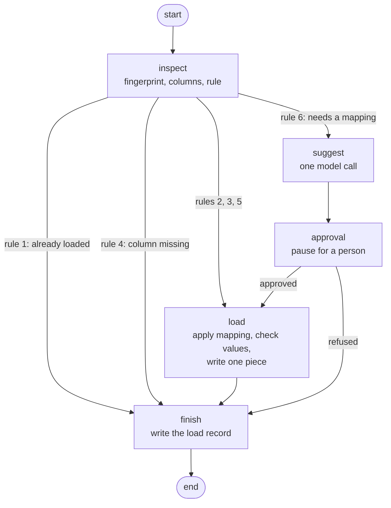

# LLD: Milestone 5, Raw data and ingestion

**Status:** Final; built
**Fits inside:** [HLD](HLD.md)

> **What this document is.** A low-level design (LLD) gives the exact detail needed to build each part named in the [HLD](HLD.md): files, tables, rules, functions, and tests. Keep it open beside the notebooks and the code. Section 12 tells you which notebook and which code file build each part.

Everything from milestones 1 to 4 is unchanged and is not repeated here: the metric definitions, the transformations, the checks, lineage, run history, the seven tools, the analyst, the verifier, and scoring.

## 1. Files

Everything lives inside `src/m5_raw_data_ingestion/`. Nothing imports from another milestone. Files marked *new* did not exist in milestone 4.

```
docs/                             BRD.md, HLD.md, LLD.md
notebooks/                        the lab: seven notebooks, lab_helpers.py, results/
data/
  landing/                        new: the files as they arrive (generated, committed)
  loaded/<feed>/<file>.parquet    new: one loaded piece per file (not committed)
  loader_state.sqlite             new: the load record and the workflows' saved state (not committed)
  approved_mappings.json          new: the mappings a person has approved
  warehouse/                      the run history, as milestone 4
retail_profit_stack/
  ingest/                         new: the loader
    feeds.py                      the feeds, and which feed a file belongs to
    rules.py                      inspects one file and chooses its rule
    ledger.py                     the load record
    mapping.py                    approved mappings; the AI's suggestion; scoring
    workflow.py                   the file workflow: a graph with saved state and a pause
    dispatch.py                   the dispatcher: many files at once
  source_data.py                  changed: writes dated files, with file problems planted
  transform/pipeline.py           changed: reads the loaded pieces
  lineage/runs.py                 changed: an input's fingerprint comes from its loaded pieces
  make_history.py                 changed: loads the files first
  everything else                 as milestone 4
evals/
  m5_mapping_cases.json           new: the true meaning of each renamed column
  other files                     as milestone 4
tests/
milestone_5_recap.html
```

## 2. One file, step by step



This is the **file workflow**. Each box is a node: a Python function that reads the state and returns the parts it changes. The state is saved after every node.

## 3. The files

The generator writes the same records as milestone 4, split into files in `data/landing/`.

| Feed | One file per | Name | Files |
|---|---|---|---|
| `orders`, `order_items`, `refunds`, `shipments`, `payment_fees` | Week, starting Monday | `<feed>_<Monday's date>.csv`, for example `orders_2026-09-14.csv` | 9 each |
| `product_costs` | Month | `product_costs_2026-09.csv` | 2 |
| `products` | Once | `products.csv` | 1 |

A record goes into the file for the week of its own date: an order by its order date, a refund by its refund date, and so on. An order line goes with its order.

That gives 48 files. Seven file problems are planted, which adds two more files, for 50.

| # | File problem | Files | Rule that must handle it |
|---|---|---|---|
| 1 | The same content sent again under a new name | `orders_2026-09-14_resend.csv` | 1: skipped |
| 2 | Columns in a different order | `refunds_2026-09-21.csv` | 2: loaded |
| 3 | An extra column, `warehouse_code` | The four `shipments` files from `2026-10-05` | 3: loaded, extra ignored |
| 4 | `return_handling_cost` missing. A complete file follows | `refunds_2026-10-12.csv`, then `refunds_2026-10-12_complete.csv` | 4: rejected. The complete one loads |
| 5 | `unit_list_price` is now `list_price`, and `discount_amount` is now `discount` | The three `order_items` files from `2026-10-12` | 6: waits |
| 6 | `fee_amount` is now `fee_usd` | The two `payment_fees` files from `2026-10-19` | 6: waits |
| 7 | `pick_pack_cost` and `carrier_cost` are now `cost_1` and `cost_2`. The names give no clue | `shipments_2026-10-26.csv` | 6: waits |

Loading all 50 with no approved mappings gives: 42 loaded, 1 skipped, 1 rejected, 6 waiting. After the six are approved: 48 loaded.

The record-level problems of milestone 3 (a record sent twice, a missing cost, and so on) are still inside the records. The loader does not touch them. The checks find them, as before.

## 4. Inspecting a file

`rules.py` holds one plain function. It reads the file's first line and its bytes, and nothing else.

```python
def inspect_file(file, expected, loaded, approved, loaded_names=None) -> Inspection
```

| Field of `Inspection` | Meaning |
|---|---|
| `fingerprint` | Milestone 4's fingerprint of the file's content |
| `missing` | Expected columns that are not in the file |
| `unknown` | Columns in the file that are not expected |
| `rule` | 1 to 7, from HLD section 5 |
| `outcome` | `already_loaded`, `skipped`, `rejected`, `load`, or `needs_mapping` |
| `reason` | One sentence in plain words |
| `mapping` | The approved mapping to apply, for rule 5 |
| `ignored` | Extra columns that will be dropped, for rule 3 |

**Rule 1 has two cases.** If the same file name loaded this content before, the outcome is `already_loaded` and nothing is written: this is what makes loading a whole batch again harmless. If another file name loaded it, the outcome is `skipped`, and the resent file gets its own row in the load record.

How rules 3 to 6 are told apart: with nothing missing, any unknown columns are extras (rule 3). With something missing and nothing unknown, the file is incomplete (rule 4). With something missing and something unknown, the file may be renamed (rules 5 and 6). An approved mapping "covers" a file when it maps the file's unknown columns onto every missing column.

## 5. The load record and the loaded pieces

Both tables live in `data/loader_state.sqlite`.

**`files_seen`**: one row per file name.

| Column | Example |
|---|---|
| `file_name` (key) | `order_items_2026-10-12.csv` |
| `feed` | `order_items` |
| `fingerprint` | `3f9a…` |
| `outcome` | `loaded`, `skipped`, `rejected`, or `waiting` |
| `rule` | `6` |
| `reason` | "list_price and discount are not expected columns" |
| `rows_loaded` | `298` |
| `mapping` | `{"list_price": "unit_list_price", "discount": "discount_amount"}` |
| `approved_by` | `Vijay` |
| `seen_at` | when the row was last written |

**`loaded_content`**: one row per fingerprint that has been loaded.

| Column | Meaning |
|---|---|
| `fingerprint` (key) | The content |
| `file_name` | The file that loaded it first |

`loaded_content` is what makes a load safe to repeat. The load step asks the database to add the fingerprint and to **do nothing if it is already there**. The database tells it which happened. If the fingerprint was already there, the file's outcome is `skipped`. This works even when two copies of a file are loaded at the same moment.

**A loaded piece** is `data/loaded/<feed>/<file name>.parquet`: the file's rows, with the expected column names, in the expected order, with the contract's types. A source table is every piece of its feed, read in file-name order and put end to end. So the order files were loaded in does not matter.

```python
def load_sources(loaded_dir) -> dict[str, pa.Table]     # changed: reads the pieces
```

**A run's inputs.** Milestone 4 recorded a fingerprint of each table's file. Now a table's fingerprint is worked out from the names and fingerprints of its pieces. Loading one more file changes it, and `compare_runs` shows that, as before.

## 6. Mappings

**Approved mappings** are kept in `data/approved_mappings.json`, by feed:

```json
{"order_items": [{"list_price": "unit_list_price", "discount": "discount_amount"}]}
```

**The AI's suggestion** is one model call that must return this shape:

| Field | Content |
|---|---|
| `columns` | One entry per unknown column: `file_column`, `expected_column` (or "none"), and `reason` in one sentence |
| `confidence` | `high` or `low` |
| `note` | Anything the person should check |

What the model is given: the feed's expected columns with their meanings, the file's column names, five rows of the file, and five rows of an earlier file from the same feed. The earlier rows matter. In file problem 7 the names `cost_1` and `cost_2` say nothing, and only the values show which is which.

```python
def mapping_prompt(feed, file, missing, unknown, earlier_rows) -> str   # everything the model is given
def suggest_mapping(model, feed, file, missing, unknown, places)        # returns (suggestion, cost)
def read_file(file, feed, mapping=None) -> pa.Table           # renames, drops extras, checks values; no model
def mapping_problem(mapping, feed, missing, unknown)          # why a mapping cannot be used, or None
def save_approved_mapping(mappings_file, feed, mapping) -> None
def score_suggestions(suggested) -> pd.DataFrame              # against evals/m5_mapping_cases.json
```

`evals/m5_mapping_cases.json` holds the true mapping for each of the six waiting files. A suggestion is **right** when every column it maps equals the truth, and **wrong** otherwise. The score is shown, never used: a person still approves.

After a mapping is applied, the values are checked against the contract's types. A price column that holds text fails, and the file is rejected. **A swap of two amount columns passes this check.** Code cannot catch it. That is the reason a person approves every mapping, and the lab shows it.

## 7. The file workflow

Built in `workflow.py` with LangGraph.

```python
class FileState(TypedDict):
    file_name: str
    feed: str
    inspection: dict          # section 4
    model_cost: float         # what the suggestion cost
    suggestion: dict          # section 6; empty when no model was asked
    mapping: dict             # the mapping to apply; empty for none
    approved_by: str
    outcome: str              # loaded, skipped, rejected, already_loaded
    reason: str
    rows_loaded: int

def build_file_workflow(places=None, model=None, saver=None) -> CompiledGraph
def run_file(workflow, file_name, callbacks=None) -> dict   # one file; a paused file returns "waiting"
```

| Node | What it does |
|---|---|
| `inspect` | Calls `inspect_file`. Writes the file to `files_seen` |
| `suggest` | Calls `suggest_mapping`. Only reached for rule 6 |
| `approval` | Marks the file `waiting`, then pauses with the suggestion. When resumed with `{"approved": true, "person": "...", "mapping": {...}}`, it saves the approved mapping and carries on. When refused, the outcome is `rejected` |
| `load` | Applies the mapping, checks the values, adds the fingerprint to `loaded_content`, and writes the piece. If the fingerprint was already there, the outcome is `skipped` |
| `finish` | Writes the final outcome to `files_seen` |

| Detail | Choice |
|---|---|
| Saved state | `SqliteSaver` on `data/loader_state.sqlite`. Every node's result is saved before the next node starts |
| Thread id | The file's name. So `get_state` for a file name shows where that file is |
| The pause | LangGraph's `interrupt()`. The person's answer may correct the mapping before approving it |
| Run again after a crash | The interrupted node runs again from its top. `inspect` and `load` are safe to repeat. `suggest` would call the model again, which costs a little and harms nothing |
| Code before a pause runs twice | So `approval` does nothing before `interrupt()` that would be wrong to do twice |

```python
def waiting_files(workflow) -> list[dict]                  # each waiting file, with its suggestion
def answer(workflow, file_name, approved, person, mapping=None) -> dict
```

`python -m retail_profit_stack.ingest.workflow` lists the waiting files and asks for a yes or no on each, in the terminal.

## 8. The dispatcher

Built in `dispatch.py`. It is a second, smaller graph, with no model in it.

```python
class Batch(TypedDict):
    files: list[str]
    results: Annotated[list, operator.add]     # each worker adds its own result

def build_dispatcher(work_file) -> CompiledGraph
def load_batch(files=None, max_concurrency=5, model=None, places=None, callbacks=None, run_name=...) -> list[dict]
def clear_loaded(places=None) -> None       # forget what was loaded; keeps landing files and mappings
```

| Part | Detail |
|---|---|
| The files | Every file in the landing folder, in name order, unless a list is passed |
| `fan_out` | Returns one `Send("work_file", file_name)` per file. LangGraph then runs `work_file` once for each |
| `work_file` | Runs the file workflow for one file, on that file's own thread. Returns the file's name, outcome, seconds, and model cost. A file that paused returns `waiting` |
| Cap | `max_concurrency` in the config: at most that many `work_file` nodes run at once |
| Retry | `RetryPolicy(max_attempts=3)` on `work_file`. A failed worker is run again after a short wait |
| With no model | A file that needs a mapping still pauses, with no suggestion. The person supplies the mapping |
| Tracing | When asked, Langfuse's handler is passed in the config, so one trace holds the whole batch |

Each file runs on its own thread, not on the dispatcher's. That is what lets one file wait for a person while the other 49 finish.

**The stand-in (lab only).** Notebook 6 first gives the dispatcher a worker that sleeps for one second and loads nothing, to show the cap, the timeline, and a retry before any model is called.

## 9. Changes to the pipeline and the fixed contracts

| Part | Change |
|---|---|
| `config.py` | New folders: `LANDING_DIR`, `LOADED_DIR`, `STATE_FILE`, `MAPPINGS_FILE`. `SOURCE_DIR` now points at the loaded pieces |
| `source_data.py` | `write_landing_files()` replaces `write_source_data()`. The records are the same. With the same seed the files are the same |
| `load_sources` | Reads loaded pieces. Its result is the same seven tables as milestone 4, with the same rows |
| `make_history` | Loads the landing files with the approved mappings, then makes `RUN-0001` and `RUN-0002` as before |
| Run record | `inputs` gains `files`: how many pieces each table was built from |
| `make_model` | Takes a `timeout`. The loader's calls are short, so the lab gives up on a stalled call after 30 seconds |
| Quarantine | One fix: splitting an empty table now works. A feed with no loaded file gives an empty table, and the pipeline still runs. The live pipeline page needs this, because it lets a person load any subset of the files |
| Tools, analyst, verifier, evaluation set, scoring | No change |

Changes to record under "Fixed contracts": none. The mock data contract of milestone 1 ends here: the source tables are now built by the loader.

Row order in a source table may differ from milestone 4, because records are now grouped by week. So a record's row number may differ. Nothing depends on that: the figures, the findings and their ids, and the number of records behind each figure are the same, and a test proves it.

## 10. Scoring the swarm

Notebook 6 scores each run of the dispatcher on the six files that need a mapping.

| Score | Meaning |
|---|---|
| `right` | Suggestions that equal the planted truth, out of six |
| `low_confidence` | Suggestions the model itself marked as unsure |
| `model_cost` | What the run's model calls cost |
| `seconds` | From the first file starting to the last finishing |
| `slowest_file` | The time the slowest file took |

The scores are sent to the run's trace in Langfuse with `create_score`. The lab compares one at a time, five at once, and all at once.

## 11. Tests

All tests run offline with no API key and no Langfuse. Any test that needs the model uses a scripted fake.

| Area | What is tested |
|---|---|
| Generator | The same seed gives the same 50 files, byte for byte. Each of the seven file problems is present |
| Rules | Each of the seven rules, on a tiny file written for it |
| Load record | A fingerprint can be added once; a second attempt reports that it was already there |
| Loading twice | Loading all files twice gives the same pieces and the same tables as loading once |
| Same records as before | The seven source tables hold the same rows as milestone 4's. Every profit figure, finding, and lineage count is equal |
| Mappings | Applying a mapping renames the columns; an approved mapping is saved and then covers the next file; values that do not fit are rejected |
| Suggestion | With a scripted fake model: a suggestion is returned in the right shape, and scored right or wrong |
| Workflow | A clean file loads without pausing. A renamed file pauses, and loads after approval. A refused file is rejected. No renamed file has a piece before approval |
| Crash and carry on | A workflow rebuilt on the same SQLite file finds the waiting file and finishes it. Running the load node twice writes one piece |
| Dispatcher | All at once gives the same tables as one at a time. The cap is respected. A worker that fails once is retried and the batch completes |
| Outcomes | With no approved mappings: 42 loaded, 1 skipped, 1 rejected, 6 waiting. With them: 48, 1, 1, 0 |
| Milestone 4's tests | Still pass |
| Notebook parity | The rule chosen by hand in the lab equals production's, for every file |

## 12. Where each part is built

The lab is seven notebooks, run in order. Each line of notebook code does one thing, and each helper is shown before it is used.

| Notebook | What the learner does | Documents shown | This document's sections | Production code |
|---|---|---|---|---|
| 1. Files arrive, by hand | Looks at the landing folder. Loads the order files the naive way. Loads one twice and counts the duplicates. Hits a renamed column and watches the load fail | BRD 1, 5 | 3 | `source_data.py` |
| 2. A loader that is safe to repeat | Fingerprints a file and refuses a second copy. Compares columns with the contract and works out the rule for every file. Builds the load record | BRD 6 and HLD 5 | 4, 5 | `ingest/rules.py`, `ingest/ledger.py` |
| 3. AI reads a changed file | Asks a model what the new columns mean, first with names only, then with sample rows. Scores it against the planted truth. Applies a mapping in code | HLD 6 and LLD 6 | 6 | `ingest/mapping.py` |
| 4. A workflow that can wait | Sees that `create_agent` is a graph. Builds the file workflow by hand: state, nodes, edges. Runs a clean file, then a renamed file that pauses. Approves it | HLD 7 and LLD 2, 7 | 2, 7 | `ingest/workflow.py` |
| 5. Crash and carry on | Pauses a file, restarts the kernel on purpose, and finds the file still waiting. Approves it. Runs the load step twice and sees one piece | HLD 7 | 5, 7 | `ingest/workflow.py`, `ingest/ledger.py` |
| 6. A swarm of file workers | Builds the dispatcher with a one-second stand-in. Tries 1, 5, and all at once, and a retry. Then loads the real files, scores the suggestions, and reads the timeline | HLD 8 and LLD 8, 10 | 8, 10 | `ingest/dispatch.py` |
| 7. The same question, from loaded files | Approves the waiting files. Runs the pipeline on the loaded records. Compares every figure with the answer key. Asks the analyst the leader's question, and maps each notebook to its production file | LLD 9, 12 | 9, 11 | `transform/pipeline.py`, `make_history.py`, `tests/` |

Notebooks 1 and 2 make no model requests. The others need the OpenRouter key, and notebook 6 also uses the Langfuse settings from milestone 4. When the lab was built, the notebooks made about 9, 2, 1, 18, and 6 requests. One suggestion costs about four hundredths of a US cent, and a full run of the lab cost about 3 US cents, most of it the analyst's answer in notebook 7.

**What the live runs showed when the lab was built.**

- The model suggested the right mapping for all six changed files, in each of the six runs that were scored. It marked the file with meaningless names (`cost_1`, `cost_2`) as low confidence every time, and sometimes one other file.
- Given the names only, the model said it could not tell which cost was which. Given five rows of the file and five of an earlier file, it worked it out from the values.
- Loading the fifty files took about 16 seconds one at a time, 5 seconds with five at once, and 4 seconds with all at once. Each run cost about a fifth of a US cent, and ended with the same 42 loaded, 1 skipped, 1 rejected, and 6 waiting.
- A model call sometimes stalled. One run took two and a half minutes because of one file: the slowest file sets the clock. The lab now gives up on a stalled call after 30 seconds and tries again.
- The figures needed no fixing. All 238 of milestone 4's tests passed on the loaded records the first time they were run.
