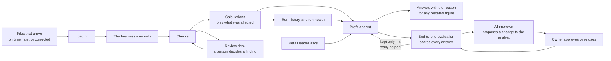

# BRD: Milestone 6, Realistic operations

**Status:** Approved by the learner; built
**Milestone:** 6 of 6 (see the project [README](../../../README.md#milestones))

> **What this document is.** A business requirements document (BRD) says what the business needs and why, in business language, with no technology. Read it first. Next, read the [HLD](HLD.md) to see what gets built to meet these needs.

## 1. Business problem

After milestone 5, Kestrel Ridge Outfitters loads its files, checks its records, calculates profit, traces every figure, and answers the leader's question. All of that assumes a tidy world: every file arrives once, complete, and on time, and a warning is something to read, not something to act on.

The real world is not tidy.

- **Records arrive late.** A refund for a September order turns up in November. September was already reported.
- **Files are corrected.** The platform sends a shipments file again with one cost fixed. Today that file is simply rejected.
- **A reported figure changes.** When that happens the leader asks "this was a different number last week, why?", and the answer must be true.
- **Nobody can act on a warning.** A finding says "needs review". Who reviews it? Where? Today, nobody and nowhere.
- **Nobody is watching the AI analyst.** Milestone 4 measured it and found weaknesses. A person fixed them by hand. That does not last: questions change, models change.

The business needs five things:

- **Late and corrected data is handled** without loading anything twice and without recalculating everything.
- **A changed figure is recorded and explained.** A changed figure for a past month is called a **restatement**.
- **A person can decide a finding**, and the system applies the decision.
- **The health of every run is visible**: what ran, how long it took, what failed.
- **The AI analyst keeps getting better, under control.** An AI may propose a change to the analyst. A person approves it. Code decides whether it really helped.

## 2. People

| Person | What they need |
|---|---|
| Retail leader | A true reason when a number they already saw has changed |
| Finance analyst | To know which past figures were restated, by how much, and because of which file |
| Data engineer | A desk for deciding findings, and a view of each run's health |
| Owner of the AI analyst | To approve or refuse each proposed change to the analyst, and to see whether it helped |
| Learner (builds the system) | To make a pipeline safe for late and corrected data, to evaluate a whole system end to end, and to build an agent that improves another agent |

## 3. The questions to answer

The leader's question from milestone 1 is unchanged:

> Which products and categories generated the most contribution profit last month, what changed, and how confident should I be in those numbers?

This milestone adds four questions:

1. **For the leader:** this figure is different from what I was told. Why?
2. **For the data engineer:** this finding needs review. What do I decide, and what happens then?
3. **For the owner of the AI analyst:** the AI proposes a change to the analyst. Should I approve it, and did it help?
4. **For the learner:** from files to answers, how good is the whole system, and how sure are we of that score?

## 4. Information flow (business view)

Two loops are new. A person decides a finding, and the next run obeys. An AI proposes a change to the analyst, a person approves, and code keeps the change only if the scores say it helped.

## 5. Words used in this milestone

| Word | Meaning |
|---|---|
| **Late record** | A record that arrives after its month was already calculated |
| **Correction** | A file sent again, with the same name and different content, to replace the earlier one |
| **Restatement** | A figure for a past month that changed after it was first reported |
| **Incremental run** | A run that recalculates only the months that new data touched |
| **Run health** | A short record of a run: what ran, how long each step took, and what went wrong |
| **End-to-end evaluation** | A test of the whole system, from files to answers, on questions whose right answers are known |
| **Held-out set** | Questions kept away from whoever is improving the system, to check a change works on questions it has not seen |
| **Judge** | An AI model that grades an explanation against a reference explanation |
| **Improver** | An AI agent that reads the analyst's mistakes and proposes a change to the analyst's instructions |

## 6. Business rules agreed with the learner

| Rule | Decision |
|---|---|
| A late file | Loaded like any other file. Its records count in the month of their own date |
| A corrected file | It replaces the earlier version of the same file. The earlier version is kept in the load record, marked as replaced |
| What is recalculated | Only the months that the new or corrected records belong to. The result must equal recalculating everything |
| A restated figure | Never overwritten silently. The run before still holds the old figure, and the comparison names the files that caused the change |
| Who decides a finding | A person, at the review desk. Two decisions are possible: **accept** (the record is right; keep counting it) or **exclude** (set the record aside) |
| What a decision does | Code applies it on the next run. An accepted record stops lowering confidence. An excluded record is quarantined, like a duplicate |
| A decision is kept | With the person's name and a note. It applies to that record in every later run |
| A missing cost | Cannot be decided at the desk. Only the vendor's cost can fix it |
| A rejected file that was never replaced | The analyst's answer for that month says data is missing, and confidence is low |
| Run health | Every run records its steps, how long each took, how many rows moved, and any warning |
| Who may change the analyst | An AI improver may **propose** a change to the analyst's instructions or model. A person approves or refuses. AI never applies its own change |
| Whether a change is kept | Code decides, from scores on questions the improver has never seen. The change is kept only if a score improves by more than chance and none gets clearly worse. Otherwise it is rolled back |
| What the improver may not touch | The business's objectives, the budget, the list of allowed models, the held-out questions, and the verifier |
| A budget | The improver stops when its evaluations have cost the amount set by the business |
| Which models | Only models available through OpenRouter. The judge is a different model from the analyst it grades |
| Spending | The learner set a limit of $5 of OpenRouter credit for building this milestone |

## 7. Scope

**In scope:** a second wave of files (a late refund, a corrected shipments file, a late product cost); corrections; incremental runs; restatements explained by the analyst; a review desk; a warning for a rejected file never replaced; run health; an end-to-end evaluation with a held-out set; a judge with a reference answer; an improver with human approval, a budget, and automatic rollback; the live pipeline page moved to this milestone.

**Out of scope:** real outside systems; scheduling; streaming; cloud deployment; sign-in for the people at the desks; the AI applying a change without approval; the improver changing the checks, the calculations, or the verifier.

## 8. Success criteria

- A late file and a corrected file load without loading anything twice.
- An incremental run gives exactly the tables a full rebuild gives.
- Running the same data again gives the same figures.
- The run history shows each restated figure, with the file that caused it, and the analyst explains it from that record.
- A decision at the review desk changes the next run as the rule says, and is recorded with a name.
- A rejected file that was never replaced lowers confidence and is named in the answer.
- Every run has a health record.
- The end-to-end evaluation runs from generated files to scored answers, on both question sets.
- The judge gives the expected grade on explanations whose grade we already know.
- The improver proposes a change, waits for approval, and code keeps or rolls back the change by the rules above.
- Every earlier milestone's figures are unchanged at month-end close.

## 9. Assumptions

- All data is fictional and generated for learning.
- The question sets are small: 18 questions and 10 held-out. Scores move by chance from run to run, so each new version is measured twice, and the lab says plainly how rough the numbers are.
- A real team would add sign-in, alerts, and a schedule. They are left out to keep the lesson on the data and the AI.
