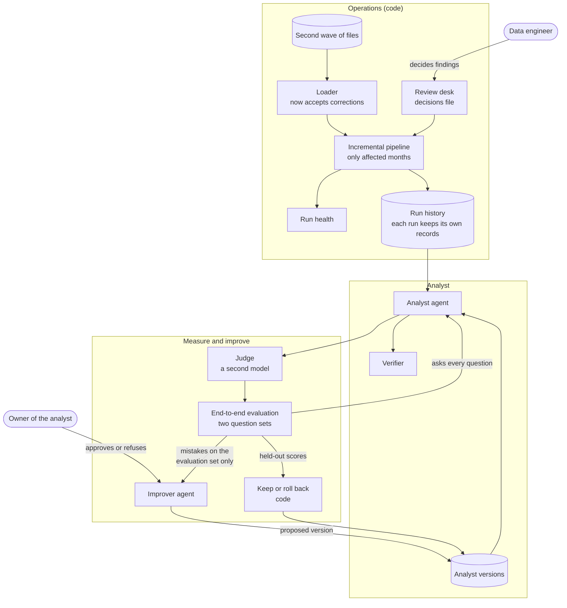

# HLD: Milestone 6, Realistic operations

**Status:** Approved by the learner; built
**Satisfies:** [BRD](BRD.md)

> **What this document is.** A high-level design (HLD) names the parts of the system, what each part does, and how data moves between them. Read it after the [BRD](BRD.md) and before the notebooks. The [LLD](LLD.md) then gives the exact detail of each part.

## 1. Approach

This milestone replaces an assumption, not a component: **that all data arrives once, complete, and in order.** It has two halves.

1. **Operations, in code.** The loader accepts corrections. The pipeline recalculates only what changed. A person decides findings at a review desk. Every run records its health. No AI decides anything here.
2. **A system that measures and improves itself.** The whole flow is evaluated end to end. A judge grades explanations. An improver proposes changes to the analyst, a person approves, and code keeps or rolls back.

## 2. What changed since milestone 5

| Part | Milestone 5 | Milestone 6 |
|---|---|---|
| Files | One wave of 50 | A second wave of 3: a late refund, a corrected shipments file, a late cost |
| Same name, different content | Rejected | A correction: it replaces the earlier version |
| A pipeline run | Recalculates everything | Can recalculate only the affected months |
| A run's folder | Its calculated tables | Also a copy of the records it used, so an old run can still be traced |
| A run's record | Inputs by table | Also the files behind each table, the mode, the months recalculated, and the run's health |
| Run comparison | What changed | Also which files were added or corrected |
| "Needs review" | A warning only | A person decides it; code applies the decision |
| Quality tool | Findings and confidence | Also names any file that is missing for the month |
| The analyst | One fixed set of instructions | Versions. The current version can be replaced, and rolled back |
| Evaluation | 14 questions, one state | 18 questions and 10 held-out, across two states: month-end close, and after the late files |
| Scoring | Right or wrong, level, cost of mistakes | Also a judge's grade for explanations |
| Improving the analyst | By hand | An improver agent, with approval and automatic rollback |

## 3. Components and data flow

## 4. Component responsibilities

| Component | Responsibility | AI? |
|---|---|---|
| Second wave of files | Three files that arrive after month-end close, written by the generator | No |
| Loader | As milestone 5. A file whose name was loaded before, with different content, now replaces the earlier version | No |
| Incremental pipeline | Find the months the changed files touch. Recalculate those months. Copy the rest from the run before | No |
| Review desk | List the findings that need review. Record a person's decision. The pipeline reads the decisions | No |
| Run health | Time and count each step of a run. Record warnings | No |
| Run history | As milestone 4. Each run now also keeps the records it used | No |
| Analyst versions | The analyst's instructions and model, as numbered versions. One is current | No |
| End-to-end evaluation | Build the data from files, ask every question in the right state, score every answer | No (it measures AI) |
| Judge | Grade an explanation against a reference explanation, from F to A | Yes |
| Improver | Read the analyst's mistakes. Propose a new version. Wait for approval. Ask for an evaluation | Yes |
| Keep or roll back | Compare held-out scores before and after. Keep the new version or return to the old one | No |

## 5. Late data, corrections, and incremental runs

**Month-end close** is the state after milestone 5's fifty files: runs `RUN-0001` and `RUN-0002`. Then three more files arrive.

| File | What it is | What it changes |
|---|---|---|
| `refunds_2026-11-09.csv` | A refund dated in September, for the fleece pullover | A September figure that was already reported |
| `shipments_2026-10-19.csv` | The same name as a loaded file, with one carrier cost corrected | An October figure |
| `product_costs_2026-10_late.csv` | The camp stove's October cost, the one missing since milestone 1 | The camp stove's October profit becomes available |

**Incremental run.** Every profit figure depends only on records dated in its own month. So if the new records are all dated in September and October, only those months need recalculating. The pipeline finds the months from the changed files, recalculates them, and copies every other month from the run before. A test proves the result equals a full rebuild.

**Each run keeps its own records.** After a correction, the records are different. To trace an old figure we need the records as they were. So each run saves the records it used in its own folder.

## 6. The review desk

| Decision | When to use it | What the next run does |
|---|---|---|
| **Accept** | The record looks odd and is right. A $60 refund on a $25 line that really was a goodwill refund | Keeps counting it. The finding is marked reviewed and no longer lowers confidence |
| **Exclude** | The record is wrong | Sets it aside, like a duplicate. The figures no longer include it |

A decision names the record, not the finding, because finding numbers can change from run to run. It carries the person's name and a note. A missing cost has no record to decide: only the cost itself can fix it.

## 7. Where AI is used and where it is not

| Task | Done by |
|---|---|
| Loading late and corrected files | Code |
| Choosing which months to recalculate | Code |
| Deciding a finding | A person |
| Applying a decision | Code |
| Explaining why a figure was restated | AI analyst, from the run comparison |
| Grading an explanation | AI judge, against a reference |
| Proposing a change to the analyst | AI improver |
| Approving a change | A person |
| Keeping or rolling back a change | Code |
| Setting objectives, budget, and allowed models | The business, in code the improver cannot change |

## 8. The end-to-end evaluation

Earlier evaluations started from data that was already built. This one starts from nothing: generate the files, load them, run the pipeline, and only then ask.

It asks questions in two states, because some questions only make sense after the late files:

| State | Run | Example question |
|---|---|---|
| **Close** | `RUN-0002` | Which products made the most contribution profit last month? |
| **After the late files** | `RUN-0003` | Why did the fleece pullover's September contribution profit change since the last run? |

There are two question sets. The **evaluation set** (18 questions) is the one everyone looks at. The **held-out set** (10 questions) asks the same kinds of question about other products and months, and is only ever used for scoring.

## 9. A judge with a reference answer

Code can check a figure. It cannot check whether an explanation gives the right reason. That is a judgement, so a model makes it.

A judge is far more reliable when it has a **reference answer** to compare against. We have one: for every "why did it change" question, code writes the true reason from the run comparison. The judge grades the analyst's explanation against it: A (same reason), B (mostly), C (partly, or vague), F (a different reason, or it contradicts).

The judge is a second, low-cost model, chosen by a live trial. Before it is trusted, it is tested on four explanations whose grade we already know.

## 10. The improver

The improver is an agent with four tools and a **recipe**: its own instructions for how to improve the analyst.

| Step of the recipe | Who acts |
|---|---|
| 1. Read the current scores and the mistakes on the evaluation set | Improver |
| 2. Propose a new version of the analyst's instructions | Improver |
| 3. Approve or refuse the proposal | **A person** |
| 4. Run the evaluation: once on the evaluation set, twice on the held-out set | Code |
| 5. Keep the new version, or roll back | **Code** |
| 6. Propose an improvement to the recipe itself | Improver, then a person approves |

Four things keep this safe:

| Guard | What it does |
|---|---|
| **Held-out scores decide** | The improver never sees the held-out questions. A change that only fixes the questions it could see will not move the held-out score. That mistake is called *overfitting* |
| **Noise** | The same analyst scores differently from run to run. A change must beat that by a set margin before it counts |
| **Tolerance** | A change that improves one score may not make another clearly worse |
| **Budget** | The improver's evaluations cost money. When the budget is spent, `run_evaluation` refuses |

## 11. Key design decisions

| Decision | Reason |
|---|---|
| The second wave lives in its own folder | The learner can see the close state and the late files apart. A corrected file can then have the same name as the original |
| A correction is accepted automatically | It is the sender's own fix. It is recorded, the old figure is kept in the run before, and the comparison shows the effect |
| Incremental by month | Every figure depends only on its own month's records, so month is the natural unit. It is easy to prove equal to a full rebuild |
| Checks still run on all records | They are fast, and a duplicate may sit in a different month from its copy. Only the calculations are incremental |
| The review desk is a plain file of decisions | The simplest thing that works. Milestone 5's pause was needed because a file had to wait. A finding does not block the run |
| A decision names a record | Finding numbers are given in order on each run and can shift |
| Each run keeps its own records | Without that, an old run could not be traced after a correction |
| The judge only grades explanations | Figures, warnings, and confidence are still checked by code, which is exact and free |
| The improver changes instructions and model only | Those are the analyst's settings. The tools, the verifier, and the data rules are the business's |
| Code keeps or rolls back | The improver wrote the change, so it must not be the one to judge it |
| The improver's first target is a weakness we measured | Milestone 4 found one older question failing with the run tool. A real problem makes a better lesson than an invented one |

## 12. Technology

As milestone 5. No new package: LangChain's `HumanInTheLoopMiddleware` pauses the improver for approval, and it needs a checkpointer, as in milestone 5. A second OpenRouter model is used for the judge.

## 13. Risks

| Risk | Handling |
|---|---|
| An incremental run differs from a full rebuild | A test compares them table by table, after every kind of late file |
| A correction is loaded twice, or the old version comes back | The fingerprint rule of milestone 5 still applies. Tests load the wave twice |
| A decision at the desk hides a real problem | Every decision is recorded with a name and a note, and can be removed. An accepted finding is still listed, marked reviewed |
| The judge is wrong | It is tested first on known cases. It grades only explanations. Its grade is one score among several |
| The improver overfits | It never sees the held-out questions, and only held-out scores decide |
| A lucky run keeps a bad change | Two held-out runs, a noise margin, and the lab says plainly that the numbers are rough |
| The improver spends too much | A budget in code, and a small-run switch. The lab also suggests a credit limit on the key itself |
| The improver proposes something unsafe | A person reads every proposal, shown as changed lines. The verifier and the tools cannot be changed |
| The milestone is too large | Each half works alone. The operations half needs no model at all |
