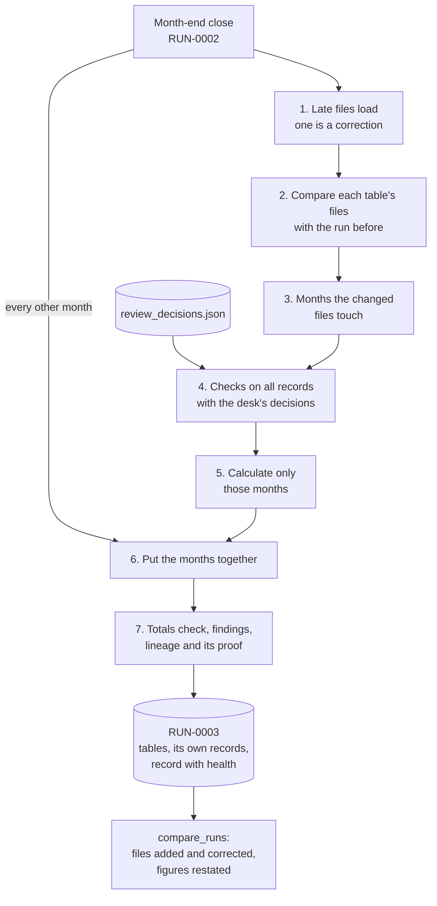

# LLD: Milestone 6, Realistic operations

**Status:** Final; built
**Fits inside:** [HLD](HLD.md)

> **What this document is.** A low-level design (LLD) gives the exact detail needed to build each part named in the [HLD](HLD.md): files, tables, rules, functions, and tests. Keep it open beside the notebooks and the code. Section 12 tells you which notebook and which code file build each part.

Everything from milestones 1 to 5 that is not named here is unchanged.

## 1. Files

Everything lives inside `src/m6_realistic_operations/`. Nothing imports from another milestone. Files marked *new* did not exist in milestone 5.

```
docs/                             BRD.md, HLD.md, LLD.md
notebooks/                        the lab: eight notebooks, lab_helpers.py, results/
data/
  landing/                        the fifty files that arrive on time, as milestone 5
  landing_late/                   new: three files that arrive after month-end close
  review_decisions.json           new: decisions made at the review desk (absent until one is made)
  analyst_versions.json           new: later versions of the analyst (absent until one is saved)
retail_profit_stack/
  quality/review.py               new: the review desk
  e2e.py                          new: the end-to-end evaluation
  judge.py                        new: the judge and the reference answer
  analyst_versions.py             new: versions of the analyst
  improver.py                     new: the improver, and the business's settings for it
  source_data.py                  changed: also writes the three late files
  ingest/rules.py, workflow.py, ledger.py   changed: a correction replaces the earlier version
  transform/pipeline.py           changed: incremental runs, decisions, run health, each run's own records
  lineage/runs.py, compare.py     changed: the files behind each table; files added and corrected
  store.py, tools.py, schemas.py  changed: read a run's own records; the run before; missing files
  agent.py, verify.py             changed: a version's instructions; two small fixes
  make_history.py                 changed: also applies the late files
evals/
  m6_cases.json                   new: the evaluation set, 18 questions
  m6_held_out.json                new: the held-out set, 10 questions
tests/
milestone_6_recap.html
```

## 2. From close to a restatement, step by step



## 3. The late files

`source_data.write_late_files()` writes three files to `data/landing_late/`. They are built from the same seed as the first wave, so they are always the same.

| File | Content | Why it is interesting |
|---|---|---|
| `refunds_2026-11-09.csv` | One refund, `REF-9001`, dated 2026-09-25, on a fleece pullover (P012) line: $71.25, handling cost $5.00 | Named for November, dated in September: a late record |
| `shipments_2026-10-19.csv` | The first wave's file of that name, with the first row's `carrier_cost` changed from 4.00 to 9.00 | The same name, different content: a correction |
| `product_costs_2026-10_late.csv` | The camp stove (P007), 2026-10, unit cost 44.00 | The cost that has been missing since milestone 1 |

What they do to contribution profit, worked by hand in notebook 1:

| Figure | At close (`RUN-0002`) | After (`RUN-0003`) | Change |
|---|---|---|---|
| Fleece pullover, 2026-09 | 3,869.25 | 3,793.00 | −76.25 |
| Trail water bottle, 2026-10 | 5,156.94 | 5,151.94 | −5.00 |
| Camp stove, 2026-10 | unavailable | 2,888.69 | no amount |

The `missing_product_cost` check goes from needs review to pass. Six findings remain, and their numbers shift: the out-of-order findings become `QF-004` and `QF-005`.

## 4. Corrections and incremental runs

**A correction.** In `rules.py`, a file whose name was loaded before, with a different fingerprint, is no longer rejected. `Inspection` gains `correction: bool`. The file then goes through rules 2 to 6 like any other, and its reason starts "A correction". In the `load` node the new piece overwrites the old one, and `ledger.record_replaced` notes the fingerprint that was replaced, in a new table `files_replaced`. There are six rules again, not seven.

**The files behind each table.** A run record's `inputs` gains `pieces` for each table: every loaded piece with its fingerprint.

**Which months.** `affected_months` in `pipeline.py` compares `pieces` with the run before. For each piece that is new or has a new fingerprint, it reads the piece and takes the month of each row's date (an order line takes its order's month). It returns `None`, meaning recalculate everything, when:

- the settings, the code fingerprints, or the desk's decisions differ from the run before;
- a piece of the run before has gone;
- the product list changed;
- the run before has no `pieces` (it was made by an earlier milestone).

**Recalculating.** `run_pipeline(..., incremental=True)`:

```python
def affected_months(previous, inputs, settings, code, decisions_print, sources, source_dir) -> list[str] | None
def rows_for_months(tables, months) -> dict      # the kept records of those months
def merge_months(recalculated, previous_folder, months) -> dict   # with every other month from the run before
```

The six transformations run on the kept records of the affected months only. Each output table is then the run before's rows for every other month, plus the new rows. This is correct because every figure depends only on records dated in its own month.

**What is not incremental.** The record checks, the totals check, and the lineage always run on all records. A duplicate can sit in a different month from its copy, and row numbers can shift when a file is added. They are fast.

**Each run keeps its own records.** A run's folder gains `sources/<table>/all.parquet`. `Store` reads a run's records from there, so `RUN-0002` is still traced from the records as they were, after the correction.

A run record gains: `mode` (`full` or `incremental`), `months_recalculated`, `decisions` (a fingerprint of the decisions file), and `health` (section 10).

**Limit.** For a corrected file, the months are read from the new version. A correction that moves a record's date into another month would also need the old month recalculated. That is not handled, and the test for the three late files would not catch it.

## 5. The review desk

`quality/review.py`. A decision is filed under a **record key**: the check, the table, and the record's own id, for example `refund_exceeds_line|refunds|REF-0002`.

```python
def decide(decisions_file, key, decision, person, note="") -> dict    # decision: "accept" or "exclude"
def remove_decision(decisions_file, key) -> None
def read_decisions(decisions_file) -> dict
def add_decisions(bad_records, numbered_sources, decisions) -> pd.DataFrame
def open_reviews(findings, finding_records) -> list[dict]             # what is still waiting
```

`run_pipeline(..., decisions_file=...)` reads the decisions and attaches them to the bad records. Then:

| Decision | In `split_records` | In `make_findings` |
|---|---|---|
| none | Kept | `needs_review`, as before |
| `accept` | Kept | Outcome `reviewed`, severity `low`, and the text ends "Reviewed by NAME: accepted as correct." |
| `exclude` | Quarantined | Outcome `quarantine`, severity `low`, and the text ends "Set aside by NAME at the review desk, and no longer counted." |

A finding takes a decision's outcome only when every one of its records has that decision. `finding_records` gains `record_key` and `decision`. `QualityFlag.outcome` gains the value `reviewed`. Because confidence follows the worst severity, a reviewed or excluded finding no longer lowers it.

A new decision changes the `decisions` fingerprint, so the next run is a full one even when `incremental=True`.

**A rejected file never replaced.** `tools.files_missing(store, month)` lists rejected files whose name carries that month's date, when no loaded file of the same feed and date exists. `get_quality_flags` returns them as `files_missing`, sets confidence to `low`, and adds a reason. `Store` takes the load record's `state_file` for this. At close the answer is empty, because `refunds_2026-10-12_complete.csv` replaced the rejected file.

## 6. The end-to-end evaluation

`e2e.py`.

```python
def build_close(folder) -> Workspace          # files, loading, RUN-0001, RUN-0002
def build_everything(folder) -> Workspace     # and the late files, RUN-0003
def open_stores(workspace) -> dict            # {"close": Store(RUN-0002), "late": Store(RUN-0003)}
def answer_and_score(case, config, stores, judge=None, callbacks=None) -> dict
def evaluate(cases, workspace, config=None, judge=None, at_once=5, ...) -> pd.DataFrame
def summary(table) -> dict
```

`build_everything` starts from an empty folder: it writes the 50 and the 3 files, loads the first wave, makes the two runs of close, loads the late files, and makes the third run incrementally. It takes about a second and calls no model.

**Stages.** `EvalCase` gains `stage` (`close` or `late`) and `reference` (the month, product, and metric the judge's reference is about). A question is answered from its stage's store. `tools.compare_runs` now compares the run its store reads with the run before it, so the same question gives a different, true answer in each stage.

**The two sets.**

| Set | File | Questions | At close | After the late files | Judged |
|---|---|---|---|---|---|
| Evaluation | `m6_cases.json` | 18: milestone 5's fourteen, and E15 to E18 | 14 | 4 | E12, E15, E16, E17 |
| Held-out | `m6_held_out.json` | 10: H1 to H10 | 8 | 2 | H7, H9 |

The quick sets (`tiny=True`) are 6 and 5 questions. Expected figures were read from the tools on a fresh build, and a test checks they still agree.

**Scores** (`summary`): `accuracy`, `grade` (the judge's average, 0 to 3, over the judged questions), `cost_of_mistakes` (milestone 4's table), `cost_per_question`, `seconds_per_question`, and `spent`.

`evaluate` runs the questions several at once, with milestone 5's dispatcher.

## 7. The judge

`judge.py`.

```python
JUDGE_MODEL = "google/gemma-4-31b-it"
GRADES = {"F": 0, "C": 1, "B": 2, "A": 3}

def reference_reason(comparison) -> str                              # written by code, no model
def grade_explanation(judge, question, reference, explanation)       # returns (Grade, cost)
```

`reference_reason` writes the true reason from a `RunComparison`: the figure before and after, any setting that changed, the files added and corrected, and the records that came, went, or were corrected. When nothing changed it says so.

`compare_runs` gained two things for this. `records_changed` has a `changed` count: records in both runs whose amount differs, which is what a correction produces. And when one month or product is asked about, `files_added` and `files_corrected` list only the files of the tables whose records changed for it. Before that fix, the analyst named all three late files when asked about one product.

| Grade | Meaning |
|---|---|
| A | The same specific reason as the reference: which file, setting, or records |
| B | The right kind of reason without the specific cause, or one part left out |
| C | Vague, or only partly the reference's reason |
| F | A different reason, a contradiction, or no reason |

Only the judged questions are graded. An answer that is missing or declined gets F. The judge's cost is added to the question's cost.

**Choosing the judge.** Two low-cost models were tried on six explanations whose grade was known: `google/gemma-4-31b-it` and `deepseek/deepseek-v4.1-flash`. Both gave the expected grade on all six. The first cost about a third as much and was faster, so it is the judge. Six grades cost about three hundredths of a US cent. In a later run the judge gave an A to "some more data was loaded", so the rubric's A was tightened to need the specific cause.

## 8. Analyst versions

`analyst_versions.py`. A version is `{version, instructions, model, reason}`.

```python
def version_one() -> dict                  # the analyst as the code defines it; never stored
def read_versions(versions_file) -> list
def current_version(versions_file) -> dict
def save_version(instructions, model, reason, versions_file) -> dict   # not current until set_current
def set_current(number, versions_file) -> None                          # an earlier number is a rollback
```

`run_analyst` gains `config` (a version) and `callbacks`. With no `config` it behaves as before. `make_model` gains `model_name`.

The analyst's instructions gained three phrases: name the files `compare_runs` shows; call `compare_runs` with the month and product asked about; and when `files_missing` is returned, say records are missing and name the files.

## 9. The improver

`improver.py`. The business's settings are constants at the top of the file.

| Setting | Value | Meaning |
|---|---|---|
| `OBJECTIVES` | accuracy 0.7, grade 2.0 | A floor on the held-out set. Below it, a version is never kept |
| `NOISE` | accuracy 0.1, grade 0.3, cost 0.15, seconds 0.5 | How far a score must improve to count |
| `TOLERANCE` | accuracy 0.1, grade 0.3, cost 0.5, seconds 1.0 | How far a score may get worse |
| `BUDGET` | 0.60 | US dollars of evaluations in one session |
| `ALLOWED_MODELS` | the default model, and `google/gemma-4-31b-it` | The models the analyst may use |

Accuracy and grade are compared as a difference. Cost and time are compared as a share of the old value.

```python
def compare_scores(new, old) -> tuple[list, list]     # better, worse
def verdict(new, old) -> tuple[bool, str]             # kept or rolled back, and why
```

`verdict`, in order: below an objective, roll back; clearly worse on any score, roll back; nothing better by more than the noise, roll back; otherwise keep.

**A session** (`Session`) holds the versions, the current version, the scoreboard, each evaluation's table, the rounds, the recipes, and what has been spent. It is given a function that evaluates one version on one set, so the lab and the tests can each pass their own.

**The four tools** (`make_tools(session)`):

| Tool | What it returns or does | Pauses for a person |
|---|---|---|
| `read_results` | The current version; average scores on both sets; the mistakes on the **evaluation set only** (question, headline, mistake, failed checks, judge's grade and reason); earlier rounds; objectives; budget left; models allowed | No |
| `propose_change(instructions, model, reason)` | Refuses a model that is not allowed. Otherwise adds a version, not yet in use | Yes |
| `run_evaluation()` | Refuses when there is no new version or the budget is spent. Otherwise runs the newest version once on the evaluation set and twice on the held-out set, averages the held-out runs, applies `verdict`, and sets the current version | No |
| `propose_recipe(recipe, reason)` | Adds a recipe for the next round | Yes |

**The agent** (`make_improver(session, model)`) is LangChain's `create_agent` with `HumanInTheLoopMiddleware` on the two proposing tools and an in-memory checkpointer. Its instructions are a short introduction and the newest recipe. `waiting_proposal(result)` returns the call it is waiting on. A person resumes with `Command(resume={"decisions": [{"type": "approve"}]})`, or with `reject` and a message.

**What the improver cannot do:** see a held-out question or answer; change a setting above; change the tools, the verifier, or the data rules; put a version into use.

## 10. Run health

`run_pipeline` times each step and records `health` in the run record:

```json
{"steps": [{"step": "load the records", "seconds": 0.014, "rows": 10136}, ...],
 "warnings": ["3 findings are waiting at the review desk."]}
```

The seven steps: load the records; check the records; set records aside; calculate; write the findings; build and prove the lineage; save the run. `rows` is what the step handled: records loaded, bad records found, records set aside, profit rows, findings, lineage rows, tables saved.

Warnings: the lineage does not add up; the profit table does not match the kept records; findings are waiting at the review desk.

## 11. Tests

All tests run offline with no API key. Where a model is needed they use a scripted fake.

| Area | What is tested |
|---|---|
| Late files | The same seed gives the same three files |
| Corrections | The corrected file replaces the earlier version; the load record notes it; there are still nine pieces; loading the late files again changes nothing |
| Incremental | The late run is incremental over two months and equals a full rebuild, table by table. A single late refund recalculates September only. A run with nothing new recalculates no month and changes no figure |
| Restatement | The comparison names the two files added, the one corrected, and exactly the three figures of section 3 |
| Old runs | After the correction, `RUN-0002` still gives 5,156.94 from 754 records |
| Scoped files | Asked about one product, `compare_runs` names only the file that affected it |
| Review desk | What is waiting; accept keeps the figures and stops lowering confidence; exclude sets the record aside and moves net sales by exactly $60; a decision forces a full run; a decision can be removed; a wrong decision is refused |
| Missing file | A rejected file never replaced is named and lowers confidence; at close nothing is missing |
| Run health | Seven steps, and the warning about the desk |
| Question sets | 18 and 10 questions, none shared; every expected figure agrees with the tools in its stage |
| Judge | The reference names the real reason in each stage; a grade is a letter, a number, and a cost |
| Versions | Add, make current, roll back |
| Verdict | Each rule, including time's wide margin |
| Improver's tools | A better version is kept and a worse one rolled back; a model not allowed is refused; a spent budget stops evaluations; only evaluation-set mistakes are shown |
| Verifier | A refusal may name the month asked about; an invented amount in a refusal still fails |
| Milestone 5's tests | Still pass, with the correction rule updated |

## 12. Where each part is built

The lab is eight notebooks, run in order. Each line of notebook code does one thing, and each helper is shown before it is used.

| Notebook | What the learner does | Documents shown | This document's sections | Production code |
|---|---|---|---|---|
| 1. Late and corrected files, by hand | Builds the system to close. Reads the three late files and works out by hand what each should do to a figure. Saves an answer key | BRD 1, 5 | 3 | `source_data.py`, `e2e.py` |
| 2. Corrections and incremental runs | Loads the late files and sees the correction. Finds the changed files by fingerprint. Runs incrementally and proves it equals a full rebuild. Reads the restatement in the run comparison | HLD 5 | 2, 4 | `ingest/rules.py`, `transform/pipeline.py`, `lineage/compare.py` |
| 3. The review desk | Lists what needs review. Excludes one record and accepts another. Watches the next run obey, confidence follow, and the lineage still add up. Sees a missing file reported | HLD 6 | 5 | `quality/review.py`, `tools.py` |
| 4. Run health and restatements | Reads each run's health. Asks the analyst the same question at close and after the late files, and gets two true answers | BRD 5 | 6, 10 | `transform/pipeline.py`, `store.py`, `agent.py` |
| 5. A judge with a reference answer | Reads the reference code wrote. Tests the judge on six explanations whose grade is known. Judges a real answer | HLD 9 | 7 | `judge.py` |
| 6. The end-to-end evaluation | Builds everything from nothing. Meets the two question sets. Scores the evaluation set once and the held-out set twice, and sees the noise | HLD 8 | 6 | `e2e.py`, `evaluation.py` |
| 7. The improver | Reads the business's settings and the verdict rule. Sees what the improver may read. Approves a proposal, and code keeps it or rolls it back. Approves a new recipe | HLD 10 | 8, 9 | `improver.py`, `analyst_versions.py` |
| 8. The whole system | Runs from files to answer. Makes a decision, applies the late files, and asks the same question again. Walks one figure back to its records. Looks back over six milestones | LLD 12 | 11 | every module, `tests/` |

Notebooks 1 to 3 make no model requests. When the lab was built, with the default small sets, the others made about 6, 12, 30, 60, and 10 requests, and a full run of the lab cost about 10 US cents. With the full question sets, notebooks 6 and 7 cost about 6 and 15 US cents.

**What the live runs showed when the lab was built.**

- The analyst got all 18 evaluation questions right in one full run, 16 of 18 in another, and every judged explanation an A. On the held-out set it scored 9 and 10 of 10.
- The held-out set's first run found a bug that had been in the verifier since milestone 1: a correct refusal that named "December 2026" was failed. The evaluation set's forecast question has no year in it, so it never triggered it.
- The same analyst, on the same questions, took 4.8 and then 10.8 seconds a question in two runs, because one model call stalled. In a later pair of runs on the small held-out set, its accuracy was 1.0 and then 0.8: one question of five.
- In the first improver trial the code kept a change because it looked faster. Nothing was faster: an earlier run had stalled. The margin for time was widened from 15% to 50%.
- That first change was a general rule about listing every amount. Held-out accuracy was 0.95 before and after, so with the wider margin it would not have been kept. In the second trial, run with the wider margin, the improver proposed shorter instructions, and the code rolled them back. Neither change moved a held-out score by more than chance. Version 1 was already near the top.
- After the second trial the improver rewrote its own recipe to stop proposing wording-only changes.
- Asked about one product after the late files, the analyst first named all three late files. The tool now returns only the files that affected what was asked about.
